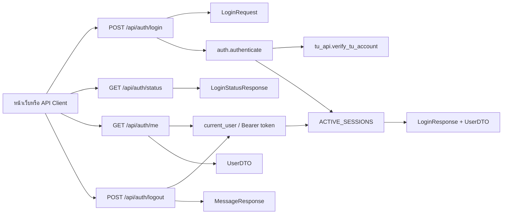

# Task5: U1 — กำหนด Login API และวิธีเก็บสถานะผู้ใช้

## ขอบเขต

เอกสารนี้กำหนดสัญญา Login API ที่มีอยู่จริงใน Backend ปัจจุบัน โดยใช้ FastAPI เป็นชั้น Router และ Pydantic เป็น DTO Schema การยืนยันบัญชีผู้ใช้ส่งต่อให้บริการ TU API ตามที่กำหนดใน Task11 ส่วนเอกสารนี้เน้นวิธีเรียก API รูปแบบข้อมูล ผลลัพธ์ ข้อผิดพลาด และการจัดการสถานะ Login

## หลักการยืนยันตัวตนและสถานะผู้ใช้

1. ผู้ใช้ส่ง `username` และ `password` ไปที่ `POST /api/auth/login`
2. Service เรียก `verify_tu_account()` เพื่อตรวจบัญชีกับ TU API หรือโหมด mock ตามการตั้งค่าใน `.env`
3. ระบบรับเฉพาะบัญชีที่ยืนยันสำเร็จ เป็นบัญชีประเภท `student` และมีสถานะ active
4. เมื่อสำเร็จ ระบบสร้าง token แบบสุ่มและเก็บความสัมพันธ์ `token -> User` ใน `ACTIVE_SESSIONS` ภายในหน่วยความจำ
5. การเรียก API ที่ต้อง Login ต้องส่ง `Authorization: Bearer <access_token>`
6. ระบบไม่เก็บ password ไว้ใน `User` หรือใน session และไม่ส่ง password กลับใน Response

สถานะผู้ใช้เป็น session แบบ in-memory สำหรับการสาธิตและการทดสอบ เมื่อ Backend restart ค่า session จะหายทั้งหมดและผู้ใช้ต้อง Login ใหม่

## API Contract

### `POST /api/auth/login`

ใช้ตรวจสอบข้อมูลบัญชีและสร้าง Login session ไม่ต้องใช้ Bearer token

#### Request

```http
POST /api/auth/login
Content-Type: application/json
```

```json
{
  "username": "student",
  "password": "password123"
}
```

| ฟิลด์ | ชนิด | กติกา |
|---|---|---|
| `username` | string | บังคับ ความยาว 1–50 ตัวอักษร ระบบจะตัดช่องว่างหัวท้ายก่อนตรวจสอบ |
| `password` | string | บังคับ ความยาว 1–100 ตัวอักษร ไม่เก็บค่าลง User หรือ session |

#### สำเร็จ — `200 OK`

```json
{
  "message": "เข้าสู่ระบบสำเร็จ",
  "access_token": "<random-session-token>",
  "token_type": "bearer",
  "user": {
    "id": 1,
    "username": "student",
    "display_name": "Student User",
    "role": "student"
  }
}
```

### `GET /api/auth/status`

ตรวจสถานะ Login โดยไม่บังคับให้มี token

#### Request

```http
GET /api/auth/status
Authorization: Bearer <access_token>
```

#### มี session — `200 OK`

```json
{
  "logged_in": true,
  "user": {
    "id": 1,
    "username": "student",
    "display_name": "Student User",
    "role": "student"
  }
}
```

#### ไม่มี token หรือ token ไม่ถูกต้อง — `200 OK`

```json
{
  "logged_in": false,
  "user": null
}
```

### `GET /api/auth/me`

อ่านข้อมูลผู้ใช้จาก session ปัจจุบัน ต้องส่ง Bearer token

```http
GET /api/auth/me
Authorization: Bearer <access_token>
```

#### สำเร็จ — `200 OK`

```json
{
  "id": 1,
  "username": "student",
  "display_name": "Student User",
  "role": "student"
}
```

### `POST /api/auth/logout`

ยกเลิก session ปัจจุบันและทำให้ token เดิมใช้เรียก `/api/auth/me` ไม่ได้

```http
POST /api/auth/logout
Authorization: Bearer <access_token>
```

#### สำเร็จ — `200 OK`

```json
{
  "message": "ออกจากระบบสำเร็จ"
}
```

## ข้อผิดพลาด

| HTTP | เงื่อนไข | รูปแบบ Response ที่ใช้อยู่ |
|---|---|---|
| `401` | username/password ไม่ถูกต้อง บัญชีไม่ active หรือ TU API ยืนยันไม่ได้ | `{"detail": "เข้าสู่ระบบไม่สำเร็จ กรุณาลองใหม่อีกครั้ง"}` |
| `401` | เรียก `/me` หรือ `/logout` โดยไม่มี Bearer token | `{"detail": "กรุณาส่ง Bearer token เพื่อยืนยันตัวตน"}` |
| `401` | token ไม่ถูกต้องหรือหมดอายุ | `{"detail": "Token ไม่ถูกต้องหรือหมดอายุ"}` |
| `422` | Request ไม่ตรงชนิดข้อมูลหรือไม่ผ่านข้อกำหนดของ Pydantic | FastAPI validation response พร้อมรายละเอียด `detail` |

ระบบใช้ข้อความ Login failure เดียวกันสำหรับข้อมูลผิด บัญชีที่ไม่ผ่านเงื่อนไข และความผิดพลาดจาก TU API เพื่อไม่เปิดเผยรายละเอียดการตรวจสอบบัญชีเกินจำเป็น

## DTO Schema ตาม Pydantic

| DTO | ใช้กับ | ฟิลด์ |
|---|---|---|
| `LoginRequest` | Request ของ `POST /api/auth/login` | `username: str`, `password: str` |
| `UserDTO` | ข้อมูลผู้ใช้ที่เปิดเผยได้ | `id: int`, `username: str`, `display_name: str`, `role: str` |
| `LoginResponse` | Response เมื่อ Login สำเร็จ | `message: str`, `access_token: str`, `token_type: str`, `user: UserDTO` |
| `LoginStatusResponse` | Response ของ `/status` | `logged_in: bool`, `user: UserDTO | null` |
| `MessageResponse` | Response ของ `/logout` | `message: str` |

ไม่รวม password ใน `UserDTO`, `LoginResponse` หรือ session data

## การแบ่งหน้าที่ของโค้ด

| ส่วน | หน้าที่ |
|---|---|
| `backend/app/routers/auth.py` | ประกาศ endpoint, อ่าน Bearer token, แปลง User เป็น `UserDTO` และกำหนด HTTP status |
| `backend/app/schemas/auth.py` | ประกาศ Request/Response DTO และ validation ด้วย Pydantic |
| `backend/app/services/auth.py` | ตรวจบัญชีผ่าน TU API, สร้าง/ค้นหา/ลบ session และสร้าง User profile ที่ไม่เก็บ password |
| `backend/app/services/tu_api.py` | ตรวจบัญชี TU API จริงหรือ mock ตาม configuration |
| `backend/app/main.py` | รวม `auth_router` เข้ากับ FastAPI application |

## แผนภาพ Router/API กับ DTO



แผนภาพนี้แสดงความสัมพันธ์ระหว่าง Client, Router, DTO, Service และ session store ตามโค้ดจริง ไม่ได้กำหนดการเก็บ session ถาวรในฐานข้อมูล

## เกณฑ์ตรวจรับ

- มีวิธีเรียก API ครบทั้ง Login, ตรวจสถานะ, อ่านผู้ใช้ปัจจุบัน และ Logout
- มี Request/Response ตัวอย่างและกติกาฟิลด์ตาม Pydantic Schema
- ระบุกรณี `401` และ `422` ตามพฤติกรรมของ API จริง
- ระบุชัดว่า session เก็บแบบ in-memory และใช้ Bearer token
- ไม่ส่งหรือเก็บ password ใน User DTO หรือ session
- แผนภาพแสดง Router/API, DTO, Service, TU API และ session store
