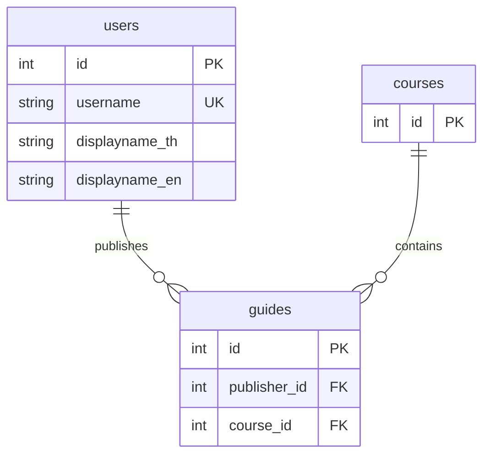
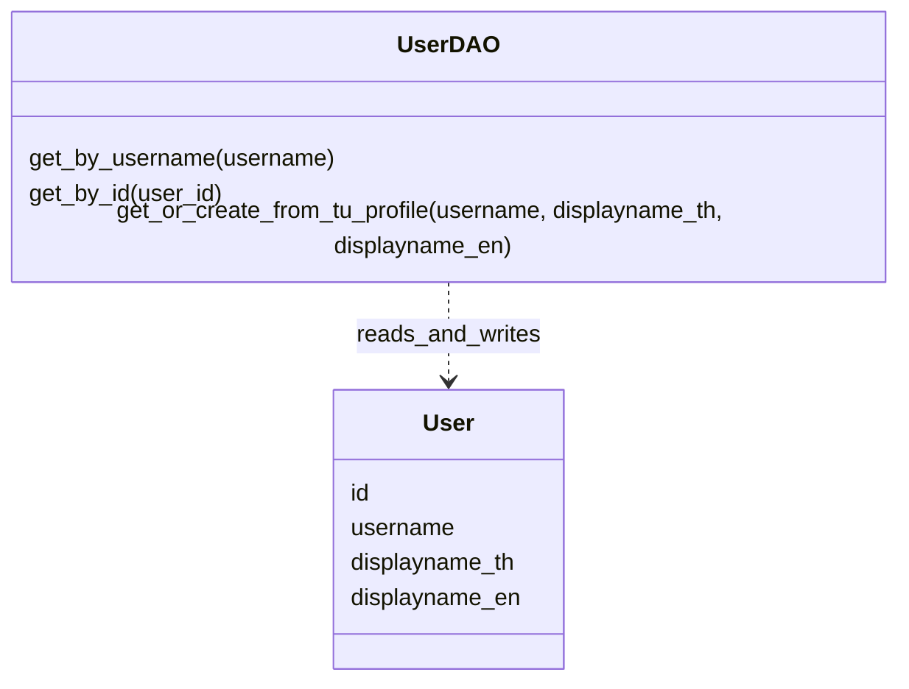

# U1 ออกแบบข้อมูลผู้ใช้และการป้องกันบัญชีซ้ำ

## 1. เป้าหมาย

กำหนดข้อมูล User สำหรับระบุผู้ใช้หลังเข้าสู่ระบบ ป้องกันการสร้างบัญชีซ้ำ และเชื่อมผู้ใช้กับแนวข้อสอบที่เผยแพร่

ระบบใช้ `username` จากผลตอบกลับ TU API เป็นตัวระบุบัญชี TU และสร้าง `users.id` เป็นคีย์ภายในระบบ

การเข้าสู่ระบบซ้ำด้วยบัญชี TU เดิมต้องคืน `users.id` เดิม

รายวิชาเป็นข้อมูลหลักสูตร 2566 ที่ทีมเตรียมไว้ผ่าน Seed โดย Course ไม่มีความสัมพันธ์กับ User ในฐานะผู้เพิ่มรายวิชา

## 2. ตาราง User

ชื่อตารางคือ `users`

| ฟิลด์ | ชนิดข้อมูล SQL Server | เว้นว่างได้ | รายละเอียดและเงื่อนไข |
|---|---|---|---|
| `id` | `INT IDENTITY` | ไม่ได้ | Primary Key เพิ่มอัตโนมัติ |
| `username` | `VARCHAR(50)` | ไม่ได้ | บัญชี TU จากผลตอบกลับ API ต้องไม่ว่างและไม่ซ้ำ |
| `displayname_th` | `NVARCHAR(255)` | ได้ | ชื่อภาษาไทยจาก TU API |
| `displayname_en` | `NVARCHAR(255)` | ได้ | ชื่อภาษาอังกฤษจาก TU API |

ความยาว 50 และ 255 เป็นค่าที่เสนอสำหรับระบบนี้ ไม่ใช่ขีดจำกัดที่เอกสาร TU API ระบุ

ความหมายของคีย์:

- **PK หรือ Primary Key** ใช้ระบุแต่ละแถว โดย `users.id` ห้ามซ้ำและห้ามว่าง
- **UK หรือ Unique Key** กำหนดให้ `users.username` ห้ามซ้ำ เพื่อป้องกันบัญชี TU เดียวกันมี User หลายแถว
- **FK หรือ Foreign Key** ใช้เชื่อมข้อมูล เช่น `guides.publisher_id` อ้างถึง `users.id`

`username` เก็บเป็นข้อความเพื่อรักษารหัสบัญชีตามที่ API ส่งมา รวมถึงเลขศูนย์นำหน้า โดยตัดช่องว่างหัวท้ายก่อนค้นหาหรือบันทึก

ฟิลด์ชื่อที่ไม่มีค่า หรือมีเฉพาะช่องว่าง เก็บเป็น `NULL`

ตาราง User ไม่มีคอลัมน์รหัสผ่าน TU หรือ Application-Key

## 3. การใช้ข้อมูลจาก TU API

ข้อมูล User มาจากผลตอบกลับ TU API ที่ขั้นตอน Login ตรวจสอบแล้ว

| ข้อมูลจาก TU API | การใช้ในระบบ |
|---|---|
| `username` | ค้นหาบัญชีเดิม และบันทึกใน `users.username` |
| `displayname_th` | บันทึกใน `users.displayname_th` |
| `displayname_en` | บันทึกใน `users.displayname_en` |
| `status`, `type` | ตรวจผลยืนยันตัวตนและประเภทบัญชีในขั้นตอน Login |
| `tu_status`, `statusid` | ใช้ประกอบกติกาสถานะบัญชีตาม Task1 หากทีมกำหนด |
| `message` | ใช้ประกอบการจัดการผลตอบกลับในขั้นตอน Login |
| `email`, `department`, `faculty` | ยังไม่มีการใช้งานในขอบเขตปัจจุบัน จึงไม่เก็บในตาราง User |

`statusid` เป็นรหัสสถานะบัญชี จึงไม่ใช้เป็นคีย์ผู้ใช้

การมี User อยู่ในฐานข้อมูลไม่ได้ใช้แทนการยืนยันตัวตนกับ TU API ในการ Login ครั้งถัดไป

### ชื่อที่ใช้แสดง

ชื่อผู้เผยแพร่อ่านจาก User ที่แนวข้อสอบอ้างถึง โดยใช้ลำดับดังนี้:

1. ใช้ `displayname_th` เมื่อมีค่า
2. ถ้าไม่มีชื่อภาษาไทย ใช้ `displayname_en`
3. ถ้าไม่มีทั้งสองชื่อ แสดง "ไม่ระบุชื่อ"

ลำดับนี้เป็นข้อเสนอสำหรับรองรับข้อมูลชื่อที่ไม่ครบ

## 4. การหาผู้ใช้เดิมและป้องกันบัญชีซ้ำ

หลัง TU API ยืนยันตัวตนสำเร็จและบัญชีผ่านกติกา Login ของ Task1 ระบบระบุ User ดังนี้:

1. อ่าน `username` จากผลตอบกลับ TU API และตัดช่องว่างหัวท้าย
2. ค้นหา User ด้วย `username`
3. ถ้าพบบัญชีเดิม ใช้ `users.id` เดิม
4. อัปเดตชื่อของบัญชีเดิม เฉพาะชื่อที่ API ส่งมาเป็นข้อความไม่ว่าง
5. ถ้าไม่พบบัญชีเดิม สร้าง User ใหม่พร้อมชื่อจาก API
6. คืน User หลังบันทึกสำเร็จให้ขั้นตอน Login ใช้สร้างสถานะเข้าสู่ระบบ

ถ้า API ไม่ส่งชื่อมา หรือส่งชื่อว่าง การ Login ซ้ำไม่ล้างชื่อเดิมในฐานข้อมูล

หากการยืนยันตัวตนไม่สำเร็จหรือบัญชีไม่ผ่านกติกา Login จะไม่มีการสร้างหรืออัปเดต User

### การ Login พร้อมกัน

ฐานข้อมูลกำหนดข้อบังคับ `UNIQUE` ที่ `username` เพื่อป้องกันบัญชีซ้ำ แม้มีหลายคำขอพยายามสร้างบัญชีเดียวกันพร้อมกัน

เมื่อการสร้าง User ไม่สำเร็จเพราะชื่อบัญชีซ้ำ ให้ยกเลิก transaction นั้น แล้วอ่าน User ที่มีอยู่เพื่อคืนคีย์เดิม

ข้อผิดพลาดฐานข้อมูลประเภทอื่นส่งให้ขั้นตอน Login จัดการ โดยไม่ถือว่าเป็นกรณีพบผู้ใช้เดิม

## 5. ความสัมพันธ์กับแนวข้อสอบ

`guides.publisher_id` เป็น `INT NOT NULL` และเป็น Foreign Key ไปยัง `users.id`

ผู้เผยแพร่กำหนดจากตัวตนผู้ใช้ที่เข้าสู่ระบบ โดยผู้เผยแพร่เป็นเจ้าของแนวข้อสอบรายการนั้น

ความสัมพันธ์มีดังนี้:

- User หนึ่งคนเผยแพร่ Guide ได้ตั้งแต่ศูนย์รายการขึ้นไป
- Guide แต่ละรายการมีผู้เผยแพร่หนึ่งคน
- Course หนึ่งวิชามี Guide ได้ตั้งแต่ศูนย์รายการขึ้นไป
- Guide แต่ละรายการอยู่ใน Course หนึ่งวิชา

ชื่อผู้เผยแพร่บนแนวข้อสอบอ่านจาก User ผ่าน `publisher_id` เมื่อชื่อจาก TU API อัปเดต รายการแนวข้อสอบแสดงชื่อปัจจุบัน

การลบ Guide ไม่ลบ User ส่วนการลบ User ที่ยังมี Guide อ้างถึงถูกปฏิเสธ

### ER Diagram

แผนภาพแสดงเฉพาะฟิลด์ของ Guide และ Course ที่เกี่ยวข้องกับความสัมพันธ์นี้ รายละเอียดของสองตารางใช้ตาม Task36 และ Task22

## 6. แบบ Entity และ DAO

### User Entity

`User` เป็น SQLAlchemy Entity ที่แทนตาราง `users` โดยมีฟิลด์:

- `id`
- `username`
- `displayname_th`
- `displayname_en`

### UserDAO

| เมธอด | ข้อมูลรับเข้า | ผลที่คืน |
|---|---|---|
| `get_by_username` | บัญชี TU ที่ตัดช่องว่างแล้ว | User หรือ `None` เมื่อไม่พบ |
| `get_by_id` | `users.id` | User หรือ `None` เมื่อไม่พบ |
| `get_or_create_from_tu_profile` | `username`, `displayname_th`, `displayname_en` ที่ผ่านการตรวจสอบจากขั้นตอน Login | User ใหม่หรือ User เดิม พร้อมข้อมูลชื่อที่อัปเดต |

`get_or_create_from_tu_profile` ใช้กติกาในข้อ 4 และคืน User หลังบันทึกสำเร็จ

DAO ทำหน้าที่เข้าถึงฐานข้อมูล ส่วนการเรียก TU API ตรวจสิทธิ์บัญชี และสร้างสถานะเข้าสู่ระบบอยู่ในขั้นตอน Login

### แผนภาพ Entity/DAO

## 7. ผลที่ต้องได้จากแบบนี้

| กรณี | ผลที่ต้องได้ |
|---|---|
| Login บัญชีใหม่สำเร็จ | สร้าง User หนึ่งรายการและคืนคีย์ใหม่ |
| Login บัญชีเดิมสำเร็จ | คืน `users.id` เดิม |
| Login บัญชีเดียวกันพร้อมกันหลายคำขอ | มี User ของบัญชีนั้นเพียงหนึ่งรายการ |
| ชื่อจาก TU API เปลี่ยน | อัปเดตชื่อโดยไม่เปลี่ยน `users.id` |
| API ไม่ส่งชื่อมาในการ Login ซ้ำ | เก็บชื่อเดิมไว้ |
| Login ไม่สำเร็จหรือไม่ผ่านกติกา | ไม่สร้างหรืออัปเดต User |
| เผยแพร่แนวข้อสอบ | ใช้ `users.id` ของผู้เข้าสู่ระบบเป็น `publisher_id` |

