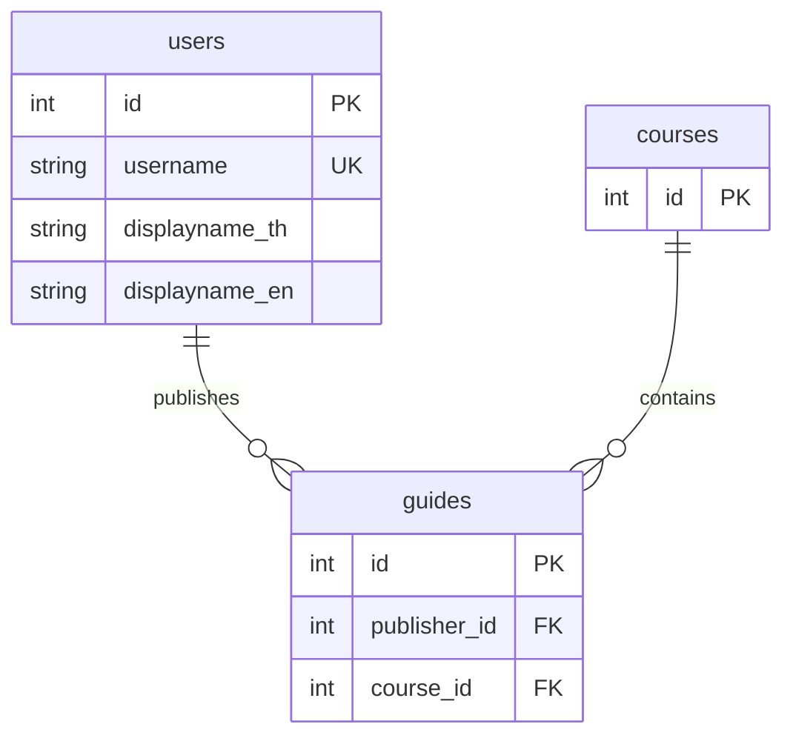
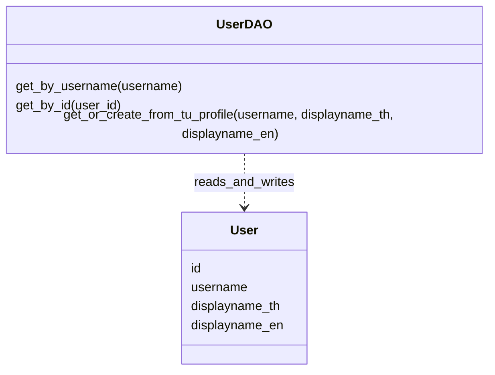

# U1 ออกแบบข้อมูลผู้ใช้และการป้องกันบัญชีซ้ำ

## 1. เป้าหมาย

กำหนดข้อมูล User สำหรับระบุผู้ใช้หลังเข้าสู่ระบบ ป้องกันการสร้างบัญชีซ้ำ และเชื่อมผู้ใช้กับแนวข้อสอบที่เผยแพร่

ระบบใช้ `username` ที่ TU adapter ยืนยันแล้วเป็นตัวระบุบัญชี TU และสร้าง `users.id` เป็นคีย์ภายในระบบ

การเข้าสู่ระบบซ้ำด้วยบัญชี TU เดิมต้องคืน `users.id` เดิม

รายวิชาเป็นข้อมูลหลักสูตร 2566 ที่ทีมเตรียมไว้ผ่าน Seed โดย Course ไม่มีความสัมพันธ์กับ User ในฐานะผู้เพิ่มรายวิชา

## 2. ตาราง User

ชื่อตารางคือ `users`

| ฟิลด์ | ชนิดข้อมูล SQL Server | เว้นว่างได้ | รายละเอียดและเงื่อนไข |
|---|---|---|---|
| `id` | `INT IDENTITY` | ไม่ได้ | Primary Key เพิ่มอัตโนมัติ |
| `username` | `VARCHAR(50)` | ไม่ได้ | บัญชี TU ที่ผ่านการยืนยัน ต้องไม่ว่างและไม่ซ้ำ |
| `displayname_th` | `NVARCHAR(255)` | ได้ | ชื่อภาษาไทยที่ UserDAO รับได้ (Login ปัจจุบันไม่ได้ส่งแยก) |
| `displayname_en` | `NVARCHAR(255)` | ได้ | ชื่อที่ Login ส่งจาก TUAccount.display_name หรือชื่ออังกฤษที่ DAO รับโดยตรง |

ความยาว 50 และ 255 เป็นค่าที่ใช้ใน Entity ปัจจุบัน ไม่ใช่ขีดจำกัดที่เอกสาร TU API ระบุ

ความหมายของคีย์:

- **PK หรือ Primary Key** ใช้ระบุแต่ละแถว โดย `users.id` ห้ามซ้ำและห้ามว่าง
- **UK หรือ Unique Key** กำหนดให้ `users.username` ห้ามซ้ำ เพื่อป้องกันบัญชี TU เดียวกันมี User หลายแถว
- **FK หรือ Foreign Key** ใช้เชื่อมข้อมูล เช่น `guides.publisher_id` อ้างถึง `users.id`

`username` เก็บเป็นข้อความเพื่อรักษารหัสบัญชีตามที่ API ส่งมา รวมถึงเลขศูนย์นำหน้า โดยตัดช่องว่างหัวท้ายก่อนค้นหาหรือบันทึก

ฟิลด์ชื่อที่ไม่มีค่า หรือมีเฉพาะช่องว่าง เก็บเป็น `NULL`

ตาราง User ไม่มีคอลัมน์รหัสผ่าน TU หรือ Application-Key

## 3. การใช้ข้อมูลจาก TU API

ข้อมูล User มาจากผลตอบกลับ TU API ที่ขั้นตอน Login ตรวจสอบแล้ว

| ข้อมูลที่ adapter ใช้ | การใช้ในระบบ |
|---|---|
| username ที่ผู้ใช้ส่ง | ตัดช่องว่างหัวท้าย แล้วใช้เป็น TUAccount.username หลังยืนยันสำเร็จ ไม่ได้อ่าน username จาก response |
| `status`, `type` | ยอมรับเฉพาะ status เป็น true และ type เป็น student |
| `displayname_th`, `displayname_en` | เลือกชื่อไทยก่อน ถ้าไม่มีจึงใช้ชื่ออังกฤษ ส่งเป็น TUAccount.display_name เพียงชื่อเดียว |
| `tu_status`, `statusid`, `message`, `email`, `department`, `faculty` | ไม่ได้ใช้กำหนด User หรือสิทธิ์ใน adapter ปัจจุบัน |

AuthService ส่งชื่อที่เลือกผ่านพารามิเตอร์ `displayname_en` ให้ UserDAO จึงอาจเก็บชื่อภาษาไทยในคอลัมน์นี้ด้วย การมีสองคอลัมน์ใน Entity ไม่ได้หมายความว่า Login ปัจจุบันเติมชื่อแยกสองภาษา

การมี User ในฐานข้อมูลไม่ใช้แทนการยืนยันตัวตนกับ TU API ในการ Login ครั้งถัดไป และไม่มีการเก็บ statusid เป็นคีย์ผู้ใช้

### ชื่อที่ใช้แสดง

ชื่อผู้เผยแพร่อ่านจาก User ที่แนวข้อสอบอ้างถึง โดยใช้ลำดับดังนี้:

1. ถ้ามีทั้งสองชื่อ แสดง `ชื่อไทย (ชื่ออังกฤษ)`
2. ถ้ามีชื่อเดียว แสดงชื่อนั้นโดยตัดช่องว่างหัวท้าย
3. ถ้าไม่มีทั้งสองชื่อ แสดง "ไม่ระบุชื่อ"

ใช้ `format_publisher_name` ร่วมกันใน service อ่านและเผยแพร่ ส่วนชื่อบัญชีที่ AuthService แสดงใช้ชื่อไทยก่อนชื่ออังกฤษและ username เป็น fallback จึงไม่ใช่กติกาเดียวกับชื่อผู้เผยแพร่

## 4. การหาผู้ใช้เดิมและป้องกันบัญชีซ้ำ

หลัง TU API ยืนยันตัวตนสำเร็จและบัญชีผ่านกติกา Login ของ Task1 ระบบระบุ User ดังนี้:

1. อ่าน `username` ที่ผ่านการยืนยันจาก TUAccount และตัดช่องว่างหัวท้าย
2. ค้นหา User ด้วย `username`
3. ถ้าพบบัญชีเดิม ใช้ `users.id` เดิม
4. อัปเดตชื่อของบัญชีเดิม เฉพาะชื่อที่ API ส่งมาเป็นข้อความไม่ว่าง
5. ถ้าไม่พบบัญชีเดิม สร้าง User ใหม่พร้อมชื่อจาก API
6. DAO flush แล้วคืน User ให้ AuthService เตรียมตัวตนและ commit ก่อนสร้าง token

UserDAO ไม่ล้างชื่อเดิมเมื่อรับพารามิเตอร์ชื่อว่าง แต่ real TU adapter จะปฏิเสธการ Login หาก response ไม่มีชื่อที่ใช้ได้ทั้งสองภาษา จึงไม่ใช่กรณี Login จริงสำเร็จโดยไม่มีชื่อ

หากการยืนยันตัวตนไม่สำเร็จหรือบัญชีไม่ผ่านกติกา Login จะไม่มีการสร้างหรืออัปเดต User

### การ Login พร้อมกัน

ฐานข้อมูลกำหนดข้อบังคับ `UNIQUE` ที่ `username` เพื่อป้องกันบัญชีซ้ำ แม้มีหลายคำขอพยายามสร้างบัญชีเดียวกันพร้อมกัน

UserDAO ครอบการสร้าง User ใหม่ด้วย `session.begin_nested()` เมื่อ insert ไม่สำเร็จเพราะ duplicate username ที่รองรับ ให้ rollback เฉพาะ savepoint แล้วอ่าน User ที่มีอยู่เพื่อคืนคีย์เดิม ไม่ rollback transaction ชั้นนอกของผู้เรียก

ข้อผิดพลาดฐานข้อมูลประเภทอื่นส่งให้ขั้นตอน Login จัดการ โดยไม่ถือว่าเป็นกรณีพบผู้ใช้เดิม

## 5. ความสัมพันธ์กับแนวข้อสอบ

`guides.publisher_id` เป็น `INT NOT NULL` และเป็น Foreign Key ไปยัง `users.id`

ผู้เผยแพร่กำหนดจากตัวตนผู้ใช้ที่เข้าสู่ระบบ โดยผู้เผยแพร่เป็นเจ้าของแนวข้อสอบรายการนั้น

ความสัมพันธ์มีดังนี้:

- User หนึ่งคนเผยแพร่ Guide ได้ตั้งแต่ศูนย์รายการขึ้นไป
- Guide แต่ละรายการมีผู้เผยแพร่หนึ่งคน
- Course หนึ่งวิชามี Guide ได้ตั้งแต่ศูนย์รายการขึ้นไป
- Guide แต่ละรายการอยู่ใน Course หนึ่งวิชา

ชื่อผู้เผยแพร่บนแนวข้อสอบอ่านจาก User ผ่าน `publisher_id` เมื่อชื่อจาก TU API อัปเดต รายการแนวข้อสอบแสดงชื่อปัจจุบัน

การลบ Guide ไม่ลบ User ส่วนการลบ User ที่ยังมี Guide อ้างถึงถูกปฏิเสธ

### ER Diagram

แผนภาพแสดงเฉพาะฟิลด์ของ Guide และ Course ที่เกี่ยวข้องกับความสัมพันธ์นี้ รายละเอียดของสองตารางใช้ตาม Task36 และ Task22

## 6. แบบ Entity และ DAO

### User Entity

`User` เป็น SQLAlchemy Entity ที่แทนตาราง `users` โดยมีฟิลด์:

- `id`
- `username`
- `displayname_th`
- `displayname_en`

### UserDAO

| เมธอด | ข้อมูลรับเข้า | ผลที่คืน |
|---|---|---|
| `get_by_username` | บัญชี TU ที่ตัดช่องว่างแล้ว | User หรือ `None` เมื่อไม่พบ |
| `get_by_id` | `users.id` | User หรือ `None` เมื่อไม่พบ |
| `get_or_create_from_tu_profile` | `username`, `displayname_th`, `displayname_en` ที่ผ่านการตรวจสอบจากขั้นตอน Login | User ใหม่หรือ User เดิม พร้อมข้อมูลชื่อที่อัปเดต |

`get_or_create_from_tu_profile` ใช้กติกาในข้อ 4 และคืน User หลัง flush โดยไม่ commit ผู้เรียกเป็นเจ้าของ transaction: AuthService commit หลังเตรียม AuthenticatedUser ส่วน PublishGuideService commit User และ Guide ร่วมกัน

DAO ทำหน้าที่เข้าถึงฐานข้อมูล ส่วนการเรียก TU API ตรวจสิทธิ์บัญชี และสร้างสถานะเข้าสู่ระบบอยู่ในขั้นตอน Login

### แผนภาพ Entity/DAO

## 7. ผลที่ต้องได้จากแบบนี้

| กรณี | ผลที่ต้องได้ |
|---|---|
| Login บัญชีใหม่สำเร็จ | สร้าง User หนึ่งรายการและคืนคีย์ใหม่ |
| Login บัญชีเดิมสำเร็จ | คืน `users.id` เดิม |
| Login บัญชีเดียวกันพร้อมกันหลายคำขอ | มี User ของบัญชีนั้นเพียงหนึ่งรายการ |
| ชื่อจาก TU API เปลี่ยน | อัปเดตชื่อโดยไม่เปลี่ยน `users.id` |
| UserDAO รับชื่อว่าง | เก็บชื่อเดิมไว้ ส่วน real Login ที่ไม่มีชื่อทั้งสองภาษาถูกปฏิเสธก่อนถึง DAO |
| Login ไม่สำเร็จหรือไม่ผ่านกติกา | ไม่สร้างหรืออัปเดต User |
| เผยแพร่แนวข้อสอบ | ใช้ `users.id` ของผู้เข้าสู่ระบบเป็น `publisher_id` |

## 8. ความสัมพันธ์ที่เพิ่มและเส้นทาง Login

ER ข้างต้นแสดงเฉพาะความสัมพันธ์ของผู้เผยแพร่ หากอธิบายฐานข้อมูลทั้งระบบปัจจุบันต้องรวม `saved_guides` ซึ่งมี `user_id` อ้าง User และ `guide_id` อ้าง Guide ด้วย ดู [ER ภาพรวม](../../U3/design/task36-db-er-entity-dao.md) และ [Sequence Login](task7-login-sequence-diagram.md)

แหล่งโค้ด: [User Entity](../../../backend/app/models/user.py), [UserDAO](../../../backend/app/dao/user_dao.py), [AuthService](../../../backend/app/services/auth.py) และ [ชื่อผู้เผยแพร่](../../../backend/app/services/publisher_name.py)

