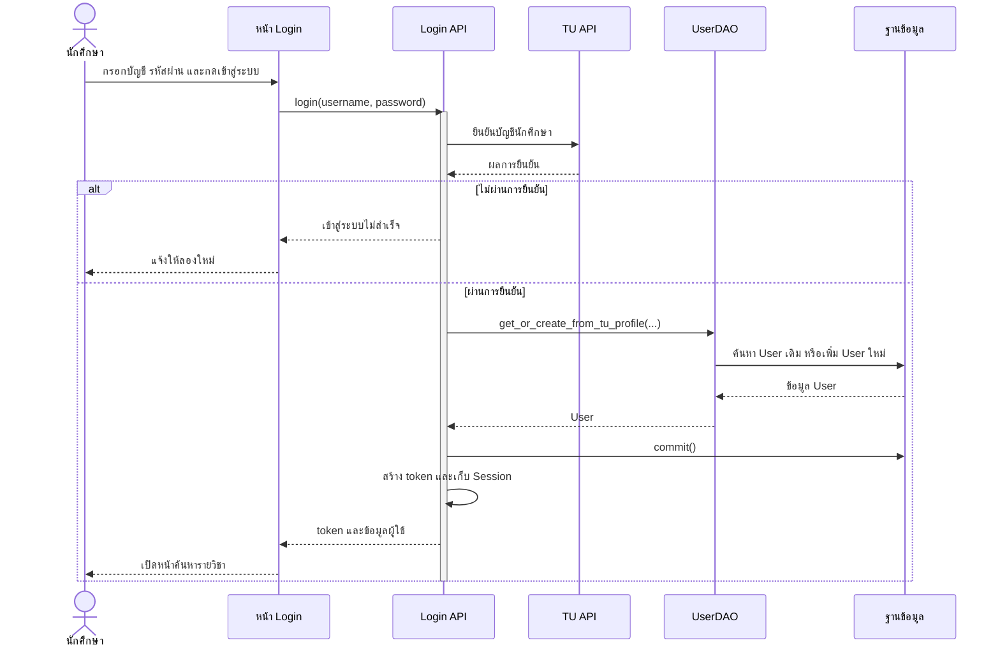
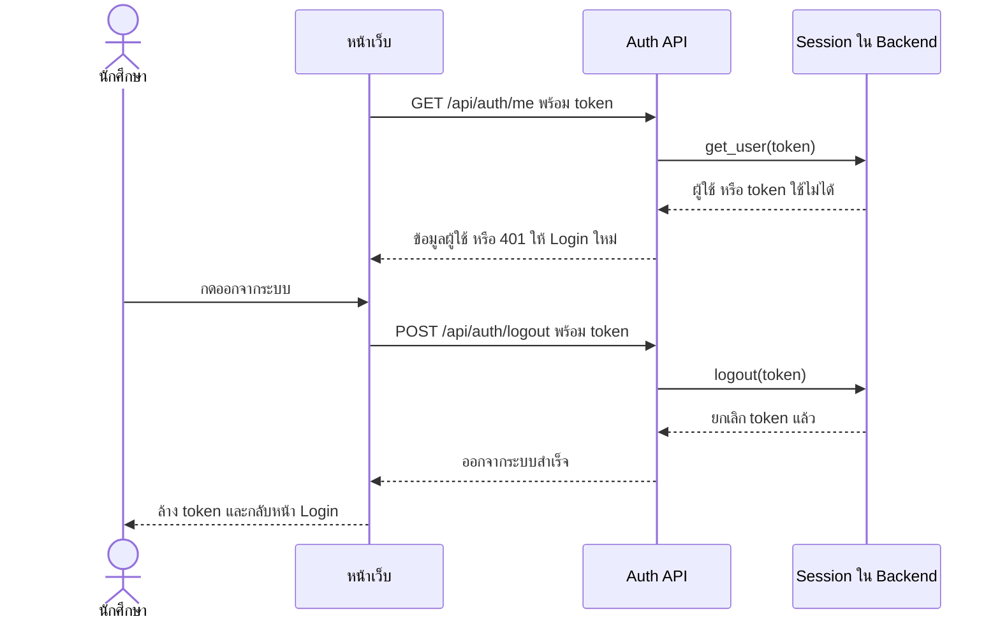

# Task7 U1 Sequence Diagram การเข้าสู่ระบบ

แผนภาพอธิบายโค้ดปัจจุบันของการ Login ด้วย TU การสร้างผู้ใช้และ Session รวมถึงการตรวจ token และ Logout ไม่ใช่ผล UAT หรือหลักฐานว่า TU API พร้อมใช้งานตลอดเวลา

ภาพใช้ระดับหน้าที่เพื่อให้อธิบายได้ง่าย: หน้าจอรวม JavaScript และ API client ส่วน API รวม Router กับ Service ภายใน Backend คำขอจาก Browser ยังผ่าน Node proxy และตรวจ Login ตามโค้ดจริง แต่ไม่แยกเป็น lifeline ในภาพ และ DAO ที่รวมไว้หมายถึง DAO หลายคลาสตามตารางอ้างอิง ชื่อ path บนลูกศรใช้ backend endpoint ยกเว้น U5 ที่ทั้งสองชั้นใช้ path เดียวกัน รายละเอียด validation และ error อยู่ในคำอธิบายประกอบ

## เข้าสู่ระบบ

Frontend ปัจจุบันใช้ข้อความ Login ไม่สำเร็จแบบเดียวสำหรับผลปฏิเสธและ upstream failure ไม่ได้แยกเหตุผลทุกกรณีตาม DoD เดิม รหัสผ่านถูกส่งเพื่อยืนยันตัวตน แต่ไม่เก็บในตาราง User หรือข้อมูลโปรไฟล์

TU adapter เลือกชื่อไทยก่อนชื่ออังกฤษเป็น `TUAccount.display_name` แล้ว AuthService ส่งชื่อนี้เข้าพารามิเตอร์ `displayname_en` ในปัจจุบัน จึงไม่ควรอธิบายว่าระบบบันทึกชื่อสองภาษาจาก TU แยกคอลัมน์ครบทุกครั้ง

## ตรวจ Session และออกจากระบบ

`GET /api/auth/status` ต่างจาก `/me`: เมื่อไม่มี Session ที่ใช้ได้จะตอบ `200 {logged_in:false}` การ restart backend ทำให้ token เดิมใช้ไม่ได้ และ Logout ที่ส่ง token หมดอายุจะถูกปฏิเสธก่อนเข้า handler

## หน้าที่และไฟล์อ้างอิง

- [login.js](../../../frontend/public/js/login.js) ตรวจฟอร์มและเก็บ token ส่วน [profile.js](../../../frontend/public/js/profile.js) โหลดบัญชีและ Logout
- [server.js](../../../frontend/src/server.js) ส่งต่อ auth endpoints และจำกัดเวลารอ upstream
- [auth router](../../../backend/app/routers/auth.py) รับ HTTP และแปลงข้อผิดพลาดเป็น response
- [dependencies.py](../../../backend/app/dependencies.py) ประกอบ dependency และตรวจ Bearer token ผ่าน `current_user`
- [AuthService](../../../backend/app/services/auth.py) ยืนยันบัญชี ควบคุม transaction และเก็บ Session
- [TU adapter](../../../backend/app/services/tu_api.py) เลือกโหมด real หรือ mock
- [UserDAO](../../../backend/app/dao/user_dao.py) เข้าถึง User โดยไม่ commit transaction ของ service
- [แบบ User และ ER](task6-db-er-entity-dao.md)
