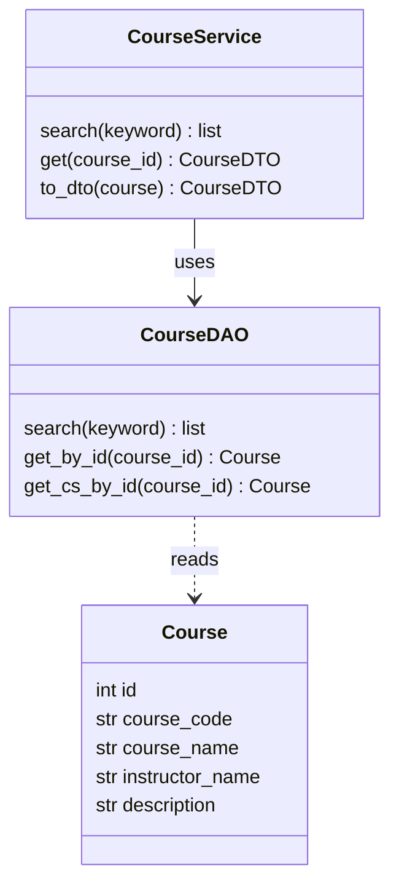
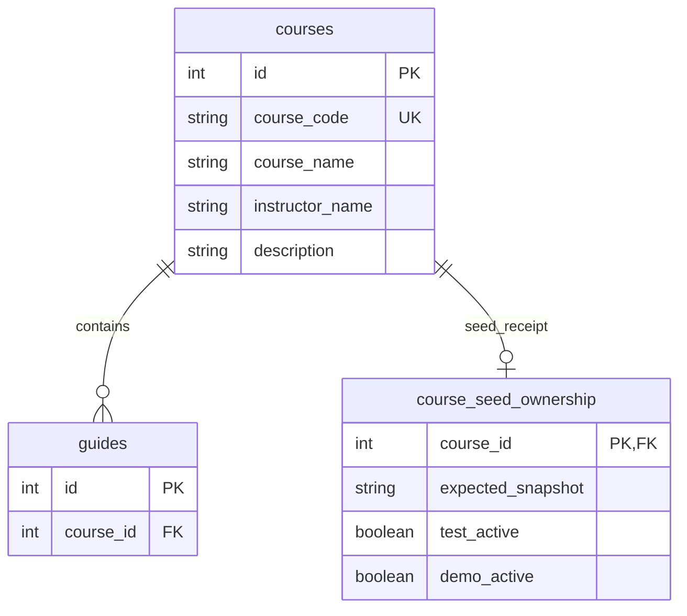

# Task22 U2 ตารางและ Entity รายวิชา

Course เป็นข้อมูลรายวิชาที่ seed ไว้ ไม่ได้สร้างจากการค้นหาหรือผูกกับผู้ใช้ในฐานะผู้เพิ่มรายวิชา เอกสารนี้อธิบาย SQL Server และ SQLAlchemy ที่ใช้งานปัจจุบัน

## โครงสร้างตาราง courses

| ฟิลด์ | ชนิดข้อมูล SQL Server | เว้นว่างได้ | เงื่อนไข |
|---|---|---|---|
| `id` | `INT IDENTITY` | ไม่ได้ | Primary Key |
| `course_code` | `VARCHAR(30)` | ไม่ได้ | Unique |
| `course_name` | `NVARCHAR(255)` | ไม่ได้ | ชื่อวิชา รองรับข้อความไทย |
| `instructor_name` | `NVARCHAR(255)` | ได้ | ข้อมูลผู้สอนที่ระดับวิชา ไม่มี instructor_name_2 |
| `description` | `NVARCHAR(max)` | ได้ | รายละเอียดวิชา |

SQLAlchemy ใช้ `String`, `Unicode` และ `UnicodeText` ตามคอลัมน์ข้างต้น ไม่ใช้ VARCHAR สำหรับข้อความไทยในชื่อวิชาและชื่อผู้สอน

## Entity และ DAO

`instructor_name` และ `description` รับ None ได้ เมธอดค้นตาม ID คืน None เมื่อไม่พบ ชนิดในภาพย่อเพื่อแสดงโครงสร้าง ตารางคอลัมน์เป็นแหล่งอ้างอิงเรื่อง nullability

`CourseService.search` เรียก `CourseDAO.search` ซึ่งจำกัดรหัส CS แล้วค้นรหัสแบบส่วนต้นหรือชื่อบางส่วน ส่วน `CourseService.get` เรียก `get_cs_by_id` เมธอด `get_by_id` ต่างออกไปเพราะตรวจเพียง ID มีอยู่ ผู้เรียก เช่น service เผยแพร่หรือแก้ไข ต้องกำหนดกติกาขอบเขตของตนเอง

## ความสัมพันธ์

Course หนึ่งวิชามี Guide ได้ศูนย์รายการขึ้นไป การลบ Guide ไม่ลบ Course และการลบ Course ที่มี Guide อ้างถึงถูก FK ปฏิเสธ

`course_seed_ownership` เป็นตารางเครื่องมือ seed มี receipt ได้ไม่เกินหนึ่งแถวต่อ Course ใช้จำว่าชุด test/demo ดูแลข้อมูลใดและตรวจ snapshot ก่อนคืนสภาพ ไม่ใช่ตารางเจ้าของรายวิชาที่เป็นนักศึกษา ค่า `expected_snapshot` ใช้ SQLAlchemy JSON ซึ่งเก็บเป็นข้อความบน SQL Server

ข้อมูลผู้สอนยังอยู่ใน DB และ DTO แต่หน้าอ่านปัจจุบันไม่ได้แสดงและไม่มีตัวกรองผู้สอน ไม่เพิ่มความสัมพันธ์ User เป็นผู้สอนจากคอลัมน์ข้อความนี้

## ไฟล์อ้างอิง

- [Course Entity](../../../backend/app/models/course.py) และ [CourseSeedOwnership](../../../backend/app/models/course_seed_ownership.py)
- [CourseDAO](../../../backend/app/dao/course_dao.py), [CourseService](../../../backend/app/services/courses.py) และ [CourseDTO](../../../backend/app/schemas/courses.py)
- [Sequence ค้นหาและเปิดวิชา](task23-course-search-sequence-diagram.md) และ [ER ภาพรวม](../../U3/design/task36-db-er-entity-dao.md)
