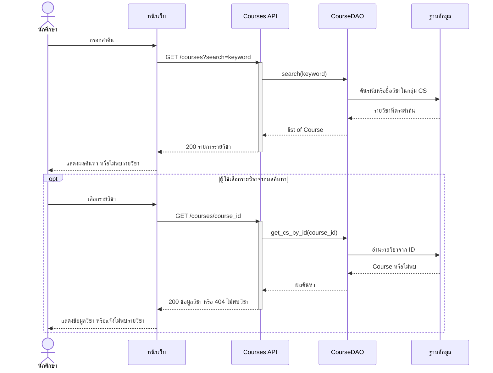

# Task23 U2 Sequence Diagram ค้นหาและเปิดรายวิชา

แผนภาพอธิบายระบบปัจจุบันตั้งแต่ Browser เรียก same-origin Node proxy จนถึง CourseService และ CourseDAO ทุก endpoint ในภาพต้อง Login ก่อน ไม่มีการสร้างรายวิชาใหม่จากคำค้น

ภาพใช้ระดับหน้าที่เพื่อให้อธิบายได้ง่าย: หน้าจอรวม JavaScript และ API client ส่วน API รวม Router กับ Service ภายใน Backend คำขอจาก Browser ยังผ่าน Node proxy และตรวจ Login ตามโค้ดจริง แต่ไม่แยกเป็น lifeline ในภาพ และ DAO ที่รวมไว้หมายถึง DAO หลายคลาสตามตารางอ้างอิง ชื่อ path บนลูกศรใช้ backend endpoint ยกเว้น U5 ที่ทั้งสองชั้นใช้ path เดียวกัน รายละเอียด validation และ error อยู่ในคำอธิบายประกอบ

## ค้นหาและเปิดรายวิชา

คำค้นว่างคืนรายวิชา CS ทั้งหมด รวมวิชาที่ไม่มีแนวข้อสอบ ค้นรหัสแบบส่วนต้นและไม่สนตัวพิมพ์ใหญ่เล็ก ส่วนชื่อใช้การค้นหาบางส่วน หากคำขอเก่าตอบช้ากว่าคำขอล่าสุด หน้าเว็บไม่ใช้ผลเก่าทับผลใหม่

Course DTO มี `id`, `course_code`, `course_name`, `instructor_name` และ `description` ไม่มี `instructor_name_2` ผลค้นหาเป็น array ส่วนผลเปิดวิชาเป็น object หากวิชาที่เลือกถูกลบระหว่างทางจะแจ้งไม่พบวิชา ไม่เปิดข้อมูลวิชาอื่นแทน

| กรณี | ผลจาก backend |
|---|---|
| ไม่พบผลค้นหา | `200 []` |
| เปิด ID ที่ไม่พบหรือวิชานอกขอบเขต CS | `404 COURSE_NOT_FOUND` |
| ไม่ได้ Login หรือ Session ใช้ไม่ได้ | `401 AUTH_REQUIRED` |
| path หรือ query ไม่ผ่าน validation | `422 INVALID_PARAMETERS` |
| ข้อผิดพลาดที่ CourseApiRoute จัดการ | `500 INTERNAL_ERROR` |

Proxy ส่งต่อ response ของ backend โดยไม่เปลี่ยนเป็นข้อมูลตัวอย่าง ถ้าติดต่อ backend ไม่ได้หรือรอเกินเวลาที่กำหนด proxy ตอบ `502` แยกจากข้อผิดพลาดฐานข้อมูลของ backend

## ไฟล์อ้างอิง

- [courses.js](../../../frontend/public/js/courses.js), [choose-courses.js](../../../frontend/public/js/choose-courses.js) และ [CourseApi](../../../frontend/public/js/course-api.js)
- [Node proxy](../../../frontend/src/server.js), [Courses Router](../../../backend/app/routers/courses.py) และ [CourseApiRoute](../../../backend/app/routers/course_errors.py)
- [CourseService](../../../backend/app/services/courses.py), [CourseDAO](../../../backend/app/dao/course_dao.py) และ [แบบ Course](task22-course-entity.md)
- [Sequence U3](../../U3/design/task37-sequence-diagram.md)

ฉบับนี้มีภาพและรายละเอียดอยู่ใน repository แล้ว ใช้แทนภาพเดิมใน Google Docs ซึ่งยังไม่สะท้อน Service, DAO และรูปแบบ response ปัจจุบัน
