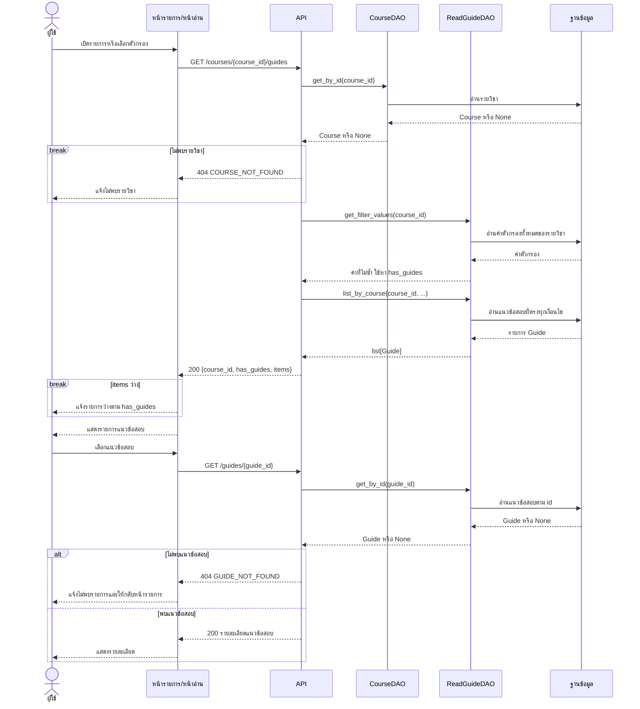

# Task 37: Sequence Diagram เลือกและอ่านแนวข้อสอบ

แผนภาพแสดงการดูรายการ กรอง และเปิดอ่านแนวข้อสอบตาม [API spec ของ Task 35](U3_%20guide%20api.md)

> เป็นแบบร่างสำหรับตรวจสอบ ปัจจุบันมี DAO แล้ว แต่ `backend/app/main.py` ยังไม่ได้ลงทะเบียน guides router และหน้าอ่านยังใช้ `CourseData`/`localStorage`

## แผนภาพ

ทุกคำขอต้องผ่านการตรวจ Login และตรวจ path/query ก่อนอ่านข้อมูล กรณีไม่ผ่านให้จบคำขอด้วย `401` หรือ `422` ตามตารางด้านล่าง

`break` หมายถึงจบการทำงานรอบนี้เมื่อเข้าเงื่อนไข จึงไม่เรียกขั้นตอนถัดไป

## รายละเอียดการเรียก

| ขั้นตอน | ข้อกำหนด |
|---|---|
| อ่านรายการ | API handler คือ `list_guides` ใช้ `courses.id` เป็น `course_id` |
| กรอง | `...` ใน `list_by_course` ย่อจากพารามิเตอร์ `academic_year`, `semester`, `exam_period` ที่เลือกส่งได้ |
| ส่งตัวกรอง | ส่งเป็น query parameters เฉพาะค่าที่เลือก เมื่อเลือก "ทั้งหมด" ให้ละ query นั้น เมื่อเปลี่ยนตัวกรองให้เรียก API รายการใหม่ |
| หา `has_guides` | API ใช้ `bool(values["academic_years"])` จาก `get_filter_values` ตามแนวทางใน Task 35 ไม่ใช้รายการหลังกรอง |
| รายการว่าง | `has_guides=false` แสดง "ยังไม่มีแนวข้อสอบสำหรับวิชานี้" ส่วน `has_guides=true` และ `items=[]` แสดง "ไม่พบแนวข้อสอบที่ตรงกับที่กรอง" พร้อมปุ่มล้างตัวกรอง ทั้งสองกรณีตอบ `200` |
| อ่านรายละเอียด | API handler คือ `read_guide` ใช้ `guides.id` เป็น `guide_id` และอ่านข้อมูลใหม่ จึงรองรับกรณีรายการถูกลบหลังโหลดหน้ารายการ |
| ข้อมูลที่ส่งกลับ | API แปลง Entity เป็น DTO ตาม Task 35 ก่อนส่ง JSON ส่วน DAO โหลด `course` และ `publisher` มาพร้อม Guide สำหรับชื่อวิชาและผู้เผยแพร่ |

ภาพนี้แสดงการใช้ตัวกรอง ส่วนการโหลดตัวเลือกในช่องกรองใช้ `GET /courses/{course_id}/guides/filter-options` ผ่าน `read_filter_options` ซึ่งตรวจรายวิชาและเรียก `ReadGuideDAO.get_filter_values(course_id)` ตาม Task 35

## ข้อผิดพลาด

รหัสและรูปแบบข้อผิดพลาดด้านล่างเป็นข้อกำหนดของ Task 35 ต้องมีตัวตรวจ Login, validation และ exception handler รองรับใน guides API

| เงื่อนไข | HTTP / code | การจัดการ |
|---|---|---|
| ไม่ได้ Login หรือสถานะใช้ไม่ได้ | `401 AUTH_REQUIRED` | จบคำขอก่อนอ่านข้อมูลและนำผู้ใช้ไปหน้า Login |
| Path/query ผิด เช่น `guide_id=0` หรือ `semester=4` | `422 INVALID_PARAMETERS` | จบคำขอก่อนอ่านข้อมูลและแจ้งข้อมูลที่ผิด |
| `CourseDAO.get_by_id` คืน `None` | `404 COURSE_NOT_FOUND` | แจ้งไม่พบรายวิชา |
| `ReadGuideDAO.get_by_id` คืน `None` | `404 GUIDE_NOT_FOUND` | แจ้งไม่พบแนวข้อสอบและให้กลับหน้ารายการ |
| อ่านฐานข้อมูลล้มเหลว | `500 INTERNAL_ERROR` | จบคำขอที่ล้มเหลวและแจ้งให้ลองใหม่ |

## แหล่งอ้างอิง

- [Task 35](U3_%20guide%20api.md) กำหนด endpoint, DTO และข้อผิดพลาด
- [ReadGuideDAO](../../backend/app/dao/read_guide_dao.py) และ [CourseDAO](../../backend/app/dao/course_dao.py) มีเมธอดตามภาพ
- [Guide](../../backend/app/models/guide.py) กำหนดความสัมพันธ์กับรายวิชาและผู้เผยแพร่
- [main.py](../../backend/app/main.py) และ [read-courses.js](../../frontend/public/js/read-courses.js) แสดงสถานะการเชื่อมต่อปัจจุบัน
