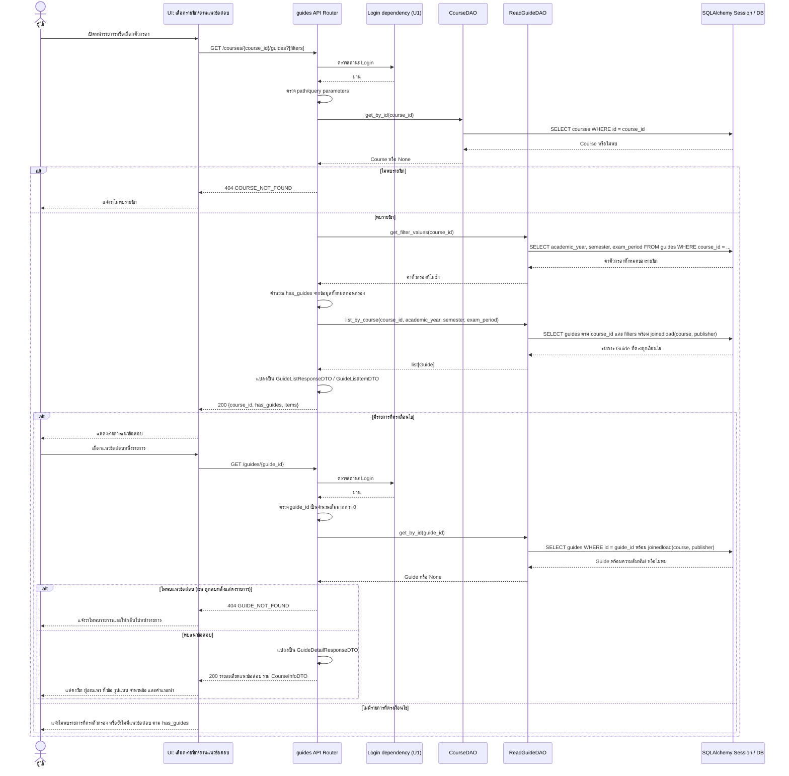

# Task 37: Sequence Diagram เลือกและอ่านแนวข้อสอบ

## ขอบเขต

แผนภาพนี้แสดง flow ต่อเนื่องตั้งแต่ผู้ใช้เปิดรายการแนวข้อสอบของรายวิชา ใช้ตัวกรอง แล้วเลือกหนึ่งรายการเพื่ออ่านรายละเอียด โดยอิง API contract ใน [Task 35: API รายการและรายละเอียดแนวข้อสอบ](U3_%20guide%20api.md), DAO ใน `backend/app/dao/read_guide_dao.py` และ Entity ใน `backend/app/models/guide.py` ครอบคลุม UI, API, DAO, ฐานข้อมูล และกรณีสำเร็จ/ผิดพลาด

> **สถานะการเชื่อมต่อ:** API อ่านแนวข้อสอบยังไม่อยู่ใน backend router ที่ลงทะเบียนใน `backend/app/main.py` และหน้าอ่านปัจจุบัน (`frontend/public/js/read-courses.js`) อ่านข้อมูลจาก `CourseData`/`localStorage` ไม่ได้เรียก API นี้ แผนภาพด้านล่างจึงเป็น flow เป้าหมายตาม contract ไม่ใช่คำยืนยันว่าระบบเชื่อมต่อครบแล้ว

## ผู้มีส่วนร่วม

| ผู้มีส่วนร่วม | บทบาท |
|---|---|
| ผู้ใช้ | เลือกรายวิชา/ตัวกรอง และเลือกรายการเพื่อเปิดอ่าน |
| UI (`choose-courses.js`, `read-courses.js`) | แสดงรายการและรายละเอียด; การเรียก API ในแผนภาพเป็น flow เป้าหมาย |
| `guides` API Router | `list_guides` และ `read_guide` ตาม Task 35 |
| Login dependency (U1) | ตรวจสถานะ Login ก่อนอ่าน API ตาม contract |
| `CourseDAO` | `get_by_id(course_id)` ใช้ตรวจว่ารายวิชามีอยู่ |
| `ReadGuideDAO` | `get_filter_values(course_id)`, `list_by_course(...)`, `get_by_id(guide_id)` |
| SQLAlchemy Session / ฐานข้อมูล | อ่านตาราง `courses`, `guides` และความสัมพันธ์ `users` สำหรับชื่อผู้เผยแพร่ |

## Sequence Diagram: เปิดรายการ กรอง และอ่านรายละเอียด

UI เรียก `GET /courses/{course_id}/guides` เมื่อเปิดรายการหรือเปลี่ยนตัวกรอง โดยส่งเฉพาะ query ที่เลือก (`academic_year`, `semester`, `exam_period`) จากนั้นเมื่อผู้ใช้เลือกรายการจึงเรียก `GET /guides/{guide_id}` เพื่อโหลดรายละเอียด

## กรณีผิดพลาด

| เงื่อนไข | จุดที่ตรวจพบ/ตอบกลับ | ผลที่ UI ควรจัดการ |
|---|---|---|
| ไม่ได้ Login หรือ Login ใช้ไม่ได้ | Login dependency ตอบ `401 AUTH_REQUIRED` ก่อนเรียก DAO ทั้งสอง endpoint | นำผู้ใช้ไปหน้า Login ตามข้อกำหนด U3 |
| `course_id`, `guide_id` หรือ query parameter ไม่ถูกต้อง (เช่น `semester=4`) | FastAPI validation ตอบ `422 INVALID_PARAMETERS` ตาม Task 35 | แสดงข้อผิดพลาดของข้อมูลเรียก API |
| ไม่มีรายวิชาตาม `course_id` | `CourseDAO.get_by_id` คืน `None`; API ตอบ `404 COURSE_NOT_FOUND` | แจ้งว่าไม่พบรายวิชา |
| ไม่มี guide ตาม `guide_id` หรือถูกลบหลังเปิดรายการ | `ReadGuideDAO.get_by_id` คืน `None`; API ตอบ `404 GUIDE_NOT_FOUND` | แจ้งว่าไม่พบรายการและให้กลับไปหน้ารายการ |
| อ่านฐานข้อมูลเกิด exception | API/exception handler ตอบ `500 INTERNAL_ERROR` | แสดงข้อผิดพลาดทั่วไปและให้ลองใหม่ |
| อ่านสำเร็จแต่ไม่มีผลลัพธ์ | API ตอบ `200`; `has_guides=false` หมายถึงไม่มีแนวข้อสอบ ส่วน `has_guides=true` และ `items=[]` หมายถึงไม่ตรงตัวกรอง | แสดงข้อความว่างที่ตรงกับสาเหตุ |

## ชื่อเมธอดและเส้นทางข้อมูล

| ขั้นตอน | เมธอด/เส้นทาง |
|---|---|
| ตรวจ Login | Login dependency ของ U1 (ชื่อ dependency จริงยังไม่ปรากฏใน guides API เพราะยังไม่มี router) |
| ตรวจรายวิชาก่อนอ่านรายการ | `CourseDAO.get_by_id(course_id)` |
| อ่านค่าทั้งหมดเพื่อคำนวณ `has_guides` | `ReadGuideDAO.get_filter_values(course_id)` |
| อ่านรายการและกรอง | `ReadGuideDAO.list_by_course(course_id, academic_year, semester, exam_period)` |
| อ่านรายละเอียดที่เลือก | `ReadGuideDAO.get_by_id(guide_id)` |
| เข้าถึงฐานข้อมูล | SQLAlchemy `Session.execute(...)` / `Session.scalars(...)`; `list_by_course` และ `get_by_id` ใช้ `joinedload(Guide.course, Guide.publisher)` |
| API handler ตาม contract | `list_guides` และ `read_guide` ใน Task 35 |

## จุดตรวจสอบก่อนถือว่า flow เชื่อมต่อครบ

- เพิ่มและลงทะเบียน guides router ใน `backend/app/main.py` พร้อม dependency ตรวจ Login และ response DTO ตาม Task 35
- ต่อ UI ให้เรียก endpoint ตาม contract; ปัจจุบัน list/read ใช้ข้อมูล local ผ่าน `CourseData`/`localStorage`
- ตรวจว่า error handler ส่งรูปแบบ `ErrorResponseDTO` สำหรับ `401`, `404`, `422`, `500` ตามที่ API spec ระบุ
- คงพฤติกรรมแยก “รายวิชายังไม่มีแนวข้อสอบ” (`has_guides=false`) ออกจาก “มีแนวข้อสอบแต่ไม่ตรงตัวกรอง” (`has_guides=true`, `items=[]`)

## เอกสารและโค้ดอ้างอิง

- `docs/U3/U3_ guide api.md` — endpoint, DTO, status/error และชื่อ Router handler ที่ออกแบบไว้
- `backend/app/dao/read_guide_dao.py` — DAO methods ที่มีอยู่จริง
- `backend/app/dao/course_dao.py` — `CourseDAO.get_by_id`
- `backend/app/models/guide.py` — ตาราง `guides` และความสัมพันธ์ `course`, `publisher`
- `backend/app/main.py` — router ที่ลงทะเบียนอยู่ใน backend ปัจจุบัน
- `frontend/public/js/read-courses.js` — flow หน้าอ่านปัจจุบันซึ่งอ่านจาก local data
