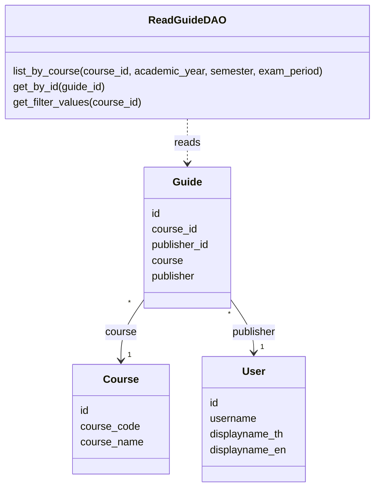

# Task36: ออกแบบข้อมูลแนวข้อสอบสำหรับอ่านและใช้ต่อ

สถานะ: แบบร่างสำหรับทีมทบทวน

## 1. เป้าหมาย

กำหนดโครงสร้างข้อมูลแนวข้อสอบให้ U3 การอ่าน, U4 การเผยแพร่ และ U5 การแก้ไขใช้ร่วมกัน รวมถึงความสัมพันธ์กับรายวิชาและผู้เผยแพร่

ระบบใช้ข้อมูลร่วมกับแบบที่ออกแบบไว้แล้ว:

- `Course` ใช้ตาราง `courses` และคีย์ `courses.id` ชนิด `INT` ตาม Task22
- `User` ใช้ตาราง `users` และคีย์ `users.id` ชนิด `INT` ตาม Task6
- `Guide` ใช้ตาราง `guides` ที่กำหนดในเอกสารนี้

รายวิชาเป็นข้อมูลหลักสูตร 2566 ที่ทีมเตรียมผ่าน Seed ส่วนแนวข้อสอบแต่ละรายการอยู่ในรายวิชาหนึ่งวิชา และมีผู้เผยแพร่หนึ่งคนเป็นเจ้าของรายการ

## 2. ตารางแนวข้อสอบ

ชื่อตารางคือ `guides`

| ฟิลด์ | ชนิดข้อมูล SQL Server | เว้นว่างได้ | รายละเอียดและเงื่อนไข |
|---|---|---|---|
| `id` | `INT IDENTITY` | ไม่ได้ | Primary Key รหัสแนวข้อสอบ เพิ่มอัตโนมัติ |
| `course_id` | `INT` | ไม่ได้ | Foreign Key ไปยัง `courses.id` |
| `publisher_id` | `INT` | ไม่ได้ | Foreign Key ไปยัง `users.id` ผู้เผยแพร่และเจ้าของรายการ |
| `title` | `NVARCHAR(200)` | ไม่ได้ | ชื่อแนวข้อสอบ |
| `academic_year` | `SMALLINT` | ไม่ได้ | ปีการศึกษาเป็น พ.ศ. เช่น `2568` |
| `semester` | `TINYINT` | ไม่ได้ | `1`, `2` หรือ `3` สำหรับซัมเมอร์ |
| `exam_period` | `VARCHAR(10)` | ไม่ได้ | `midterm` หรือ `final` |
| `topics` | `NVARCHAR(2000)` | ไม่ได้ | หัวข้อที่เคยออกสอบ เป็นข้อความหลายบรรทัด |
| `exam_format` | `VARCHAR(10)` | ไม่ได้ | `objective`, `subjective` หรือ `mixed` |
| `objective_count` | `INT` | ได้ | จำนวนข้อปรนัย ถ้าระบุต้องมากกว่า 0 |
| `subjective_count` | `INT` | ได้ | จำนวนข้ออัตนัย ถ้าระบุต้องมากกว่า 0 |
| `additional_advice` | `NVARCHAR(2000)` | ได้ | คำแนะนำเพิ่มเติม |

ความยาวชื่อ 200 และข้อความ 2,000 เป็นค่าที่เสนอ ต้องใช้ตรงกันในฟอร์มเผยแพร่ ฟอร์มแก้ไข และการตรวจข้อมูลฝั่ง Backend

ชื่อแนวข้อสอบซ้ำกันได้ เพราะอาจเป็นรายการของคนละปี ช่วงสอบ หรือผู้เผยแพร่ โดยแต่ละรายการมี `guides.id` ของตนเอง

## 3. ค่าตัวเลือกและข้อมูลที่ไม่ระบุ

### ค่าตัวเลือก

| ฟิลด์ | ค่าที่เก็บ | ข้อความที่แสดง |
|---|---|---|
| `semester` | `1` | ภาคเรียนที่ 1 |
| `semester` | `2` | ภาคเรียนที่ 2 |
| `semester` | `3` | ซัมเมอร์ |
| `exam_period` | `midterm` | กลางภาค |
| `exam_period` | `final` | ปลายภาค |
| `exam_format` | `objective` | ปรนัย |
| `exam_format` | `subjective` | อัตนัย |
| `exam_format` | `mixed` | ผสม |

ปีการศึกษาเก็บเป็นตัวเลข พ.ศ. โดยไม่กำหนดรายการปีตายตัวในตาราง ตัวเลือกปีสำหรับกรองอ่านจากแนวข้อสอบที่มีอยู่ในรายวิชานั้น

### ข้อมูลบังคับ

วิชา ชื่อ ปีการศึกษา ภาคเรียน ช่วงสอบ หัวข้อ และรูปแบบข้อสอบเป็นข้อมูลบังคับ

ชื่อและหัวข้อต้องมีข้อความหลังตัดช่องว่างหัวท้าย ส่วน `course_id` และ `publisher_id` ต้องอ้างถึงข้อมูลที่มีอยู่จริง

### ข้อมูลที่เว้นได้

- จำนวนข้อที่ไม่ระบุเก็บเป็น `NULL`
- จำนวนข้อที่ระบุต้องเป็นจำนวนเต็มมากกว่า 0
- คำแนะนำที่ไม่ได้กรอกหรือมีเฉพาะช่องว่างเก็บเป็น `NULL`
- หน้าอ่านแสดงข้อมูลที่ไม่ระบุเป็นข้อความ "ไม่ระบุ"

ค่า `0` ไม่ใช้แทนจำนวนข้อที่ไม่ระบุ และข้อความ "ไม่ระบุ" ไม่เก็บลงคอลัมน์จำนวนข้อ

### จำนวนข้อแต่ละรูปแบบ

| รูปแบบข้อสอบ | `objective_count` | `subjective_count` |
|---|---|---|
| ปรนัย | จำนวนเต็มมากกว่า 0 หรือ `NULL` | ต้องเป็น `NULL` |
| อัตนัย | ต้องเป็น `NULL` | จำนวนเต็มมากกว่า 0 หรือ `NULL` |
| ผสม | จำนวนเต็มมากกว่า 0 หรือ `NULL` | จำนวนเต็มมากกว่า 0 หรือ `NULL` |

สำหรับแบบผสม ร่างนี้เสนอให้เว้นจำนวนแต่ละส่วนแยกกันได้ หน้าอ่านแสดงทั้งสองส่วน เช่น "ปรนัย 20 ข้อ, อัตนัยไม่ระบุ" กติกานี้ต้องทบทวนร่วมกับคนทำฟอร์มเผยแพร่และแก้ไข

## 4. ความสัมพันธ์และแหล่งข้อมูลที่ใช้แสดง

| ข้อมูลบนหน้าจอ | แหล่งข้อมูล |
|---|---|
| ชื่อแนวข้อสอบและข้อมูลการสอบ | ตาราง `guides` |
| รหัสวิชา | `Course.course_code` ผ่าน `guides.course_id` |
| ชื่อวิชา | `Course.course_name` ผ่าน `guides.course_id` |
| ชื่อผู้สอน | ข้อมูลพื้นฐานของ Course |
| ชื่อผู้เผยแพร่ | `User.displayname_th` หรือ `User.displayname_en` ผ่าน `guides.publisher_id` |

ข้อมูลผู้สอนอยู่ใน Course ตามข้อสรุป Scrum ส่วนชื่อฟิลด์ `instructor_names` เป็นข้อเสนอที่รอเจ้าของ Task22 ยืนยัน

### ผู้เผยแพร่และเจ้าของรายการ

เมื่อเผยแพร่แนวข้อสอบ ระบบใช้ `users.id` ของผู้ใช้ที่เข้าสู่ระบบเป็น `publisher_id` ตามแบบ User ของ Task6

การ Login ซ้ำคืน User คนเดิม จึงทำให้แนวข้อสอบยังอ้างถึงเจ้าของคนเดิม แม้ชื่อจาก TU API เปลี่ยน

ชื่อที่ใช้แสดงยึดกติกาของ Task6:

1. ใช้ `displayname_th` เมื่อมีค่า
2. ถ้าไม่มีชื่อภาษาไทย ใช้ `displayname_en`
3. ถ้าไม่มีทั้งสองชื่อ แสดง "ไม่ระบุชื่อ"

ชื่อผู้เผยแพร่อ่านจากตาราง User ในฐานข้อมูลของระบบ เมื่อข้อมูลชื่ออัปเดต แนวข้อสอบแสดงชื่อปัจจุบันของบัญชีนั้น

### ข้อกำหนดความสัมพันธ์

- Course หนึ่งวิชามี Guide ได้ตั้งแต่ศูนย์รายการขึ้นไป
- User หนึ่งคนเผยแพร่ Guide ได้ตั้งแต่ศูนย์รายการขึ้นไป
- Guide แต่ละรายการมี Course และผู้เผยแพร่อย่างละหนึ่งรายการ
- Course ไม่มีความสัมพันธ์กับ User ในฐานะผู้เพิ่มรายวิชา
- การแก้ไขแนวข้อสอบยังใช้ `guides.id` เดิม
- การลบ Guide ไม่ลบ Course หรือ User
- การลบ Course หรือ User ที่ยังมี Guide อ้างถึงถูกปฏิเสธ

## 5. ER Diagram

```mermaid
erDiagram
    courses ||--o{ guides : contains
    users ||--o{ guides : publishes

    courses {
        int id PK
        string course_code
        string course_name
    }

    users {
        int id PK
        string username UK
        string displayname_th
        string displayname_en
    }

    guides {
        int id PK
        int course_id FK
        int publisher_id FK
        string title
        int academic_year
        int semester
        string exam_period
        string topics
        string exam_format
        int objective_count
        int subjective_count
        string additional_advice
    }
```

แผนภาพแสดงเฉพาะฟิลด์ของ Course ที่เกี่ยวข้องกับแนวข้อสอบ ส่วนข้อมูล User ใช้ตาม Task6 ชนิดข้อมูล SQL และการเว้นว่างของ Guide ใช้ตามข้อ 2

## 6. แบบ Entity และ DAO

### Guide Entity

`Guide` เป็น SQLAlchemy Entity ที่แทนตาราง `guides` โดยมีฟิลด์ตามข้อ 2 และความสัมพันธ์:

- `course` อ้างถึง Course ผ่าน `course_id`
- `publisher` อ้างถึง User ผ่าน `publisher_id`

ทีมอ่าน เผยแพร่ และแก้ไขใช้ Guide Entity เดียวกัน ส่วน Course และ User ใช้ Entity ที่ออกแบบใน Task22 และ Task6

### ReadGuideDAO

ร่างนี้ใช้คลาส `ReadGuideDAO` รวมเมธอดอ่านข้อมูลแนวข้อสอบจากฐานข้อมูล

| เมธอด | ข้อมูลรับเข้า | ผลที่คืน |
|---|---|---|
| `list_by_course` | `course_id`, `academic_year`, `semester`, `exam_period` โดยตัวกรองทั้งสามเว้นได้ | รายการ Guide พร้อมความสัมพันธ์ Course และ User ที่ใช้แสดงผล |
| `get_by_id` | `guide_id` ซึ่งตรงกับ `guides.id` | Guide พร้อมความสัมพันธ์ Course และ User หรือ `None` เมื่อไม่พบ |
| `get_filter_values` | `course_id` | ชุดค่าปีการศึกษา ภาคเรียน และช่วงสอบที่ไม่ซ้ำของวิชานั้น |

ผลจาก `get_filter_values` ประกอบด้วย:

- `academic_years` เป็นรายการตัวเลขปีการศึกษา
- `semesters` เป็นรายการรหัสภาคเรียน
- `exam_periods` เป็นรายการรหัสช่วงสอบ

กติกาของเมธอดอ่าน:

1. `list_by_course` จำกัดผลให้อยู่ในรายวิชาที่ขอเสมอ
2. ตัวกรองหลายตัวต้องตรงครบทุกเงื่อนไข
3. ตัวกรองที่ไม่ได้เลือกใช้ `None` และไม่เพิ่มเงื่อนไขนั้น
4. เมื่อไม่มีผลลัพธ์ `list_by_course` คืนรายการว่าง
5. `get_filter_values` ใช้แนวข้อสอบทั้งหมดของรายวิชานั้นเป็นแหล่งตัวเลือก
6. เมื่อไม่มีแนวข้อสอบ ชุดค่าตัวกรองเป็นรายการว่าง หน้าเว็บยังมีตัวเลือก "ทั้งหมด"
7. การอ่านข้อมูลไม่เปลี่ยนข้อมูลในฐานข้อมูล

ตัวเลือก "ทั้งหมด" เป็นสถานะของการกรอง โดยไม่มีค่าดังกล่าวเก็บในตาราง Guide

การตรวจสถานะเข้าสู่ระบบอยู่ในขั้นตอน API และ Service ที่เรียก DAO

### แผนภาพ Entity/DAO

## 7. ข้อตกลงร่วมกับงานอื่น

| เรื่อง | งานที่เกี่ยวข้อง | สถานะ |
|---|---|---|
| `course_id` อ้างถึง `courses.id` ชนิด `INT` | Task22 | ยืนยันจากแบบ Course แล้ว |
| `publisher_id` อ้างถึง `users.id` ชนิด `INT` | Task6 | ยืนยันจากแบบ User แล้ว |
| การเลือกชื่อไทย ชื่ออังกฤษ หรือ "ไม่ระบุชื่อ" | Task6 | ใช้กติกาเดียวกับแบบ User |
| ข้อมูลผู้สอนใน Course | Task22 และ Task21 | รอเพื่อนปรับแบบตามข้อสรุป Scrum |
| รหัสตัวเลือก ความยาวข้อความ และจำนวนข้อแบบผสม | งานออกแบบฟอร์มเผยแพร่และแก้ไข | เป็นข้อเสนอที่ต้องตกลงร่วมกัน |
| รูปแบบ API ที่ใช้ข้อมูลและเมธอดอ่านเหล่านี้ | Task35 | ใช้แบบนี้ออกแบบต่อ |

## 8. เอกสารส่งมอบ

Task36 ส่งมอบ:

- Database Design ระบุฟิลด์ ชนิดข้อมูล คีย์ ค่าที่เว้นได้ และข้อกำหนดข้อมูล
- ER Diagram แสดงความสัมพันธ์ Guide, Course และ User
- แผนภาพ Entity/DAO ระบุความสัมพันธ์ เมธอด ข้อมูลรับเข้า และผลที่คืน
- หลักฐานการทบทวน พร้อมลิงก์ไฟล์และ commit บน GitHub

Task36 พร้อมส่งต่อเมื่อทีมใช้ชื่อฟิลด์ คีย์ และกติกาข้อมูลตรงกัน คนทำ Task35 ใช้กำหนด API ต่อ และคนทำ Task39 ใช้สร้างตารางกับ Entity