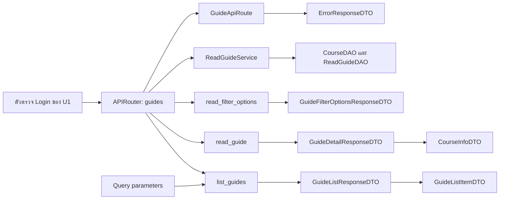

# Task35: กำหนด API รายการและรายละเอียดแนวข้อสอบ

เอกสารนี้อธิบาย API อ่านแนวข้อสอบที่ลงทะเบียนและใช้งานแล้ว

## 1. เป้าหมายและกติกากลาง

กำหนด API สำหรับอ่านรายการแนวข้อสอบ อ่านรายละเอียด และอ่านตัวเลือกการกรอง โดยใช้ข้อมูลตาม Task36

API ทั้งหมด:

- ใช้ HTTP method `GET`
- ส่งผลตอบกลับเป็น JSON
- ต้องผ่านตัวตรวจสถานะ Login ของ U1
- ผู้ใช้ที่ Login สามารถอ่านแนวข้อสอบของตนเองและผู้อื่นได้
- ใช้ `courses.id` เป็นรหัสรายวิชา และ `guides.id` เป็นรหัสแนวข้อสอบ

ข้อมูลรับเข้าของ API ชุดนี้อยู่ใน Path และ Query parameters โดยไม่มี Request body

การส่งสถานะ Login ใช้รูปแบบเดียวกับ U1 ส่วน API อ่านข้อมูลจากฐานข้อมูลของระบบ

## 2. รายการ API

| Method | URL | หน้าที่ | DAO ที่ใช้ |
|---|---|---|---|
| GET | `/courses/{course_id}/guides` | อ่านรายการและกรองแนวข้อสอบของรายวิชา | `list_by_course` |
| GET | `/guides/{guide_id}` | อ่านรายละเอียดแนวข้อสอบหนึ่งรายการ | `get_by_id` |
| GET | `/courses/{course_id}/guides/filter-options` | อ่านตัวเลือกการกรองของรายวิชา | `get_filter_values` |

API ที่รับ `course_id` ต้องตรวจว่ารายวิชามีอยู่จริงก่อนคืนผล หากไม่มีรายวิชา ให้ตอบ `404 COURSE_NOT_FOUND`

## 3. API อ่านรายการและกรองแนวข้อสอบ

### วิธีเรียก

```http
GET /courses/{course_id}/guides
```

ตัวอย่างอ่านทั้งหมดของวิชา 1:

```http
GET /courses/1/guides
```

ตัวอย่างกรองหลายเงื่อนไข:

```http
GET /courses/1/guides?academic_year=2568&semester=1&exam_period=final
```

### ข้อมูลรับเข้า

| ตำแหน่ง | ชื่อ | ชนิดข้อมูล | บังคับ | ค่าที่รับ |
|---|---|---|---|---|
| Path | `course_id` | integer | ใช่ | จำนวนเต็มมากกว่า 0 |
| Query | `academic_year` | integer | ไม่ | ปี พ.ศ. เป็นจำนวนเต็มบวกที่อยู่ในช่วงชนิด `SMALLINT` |
| Query | `semester` | integer | ไม่ | `1`, `2`, `3` |
| Query | `exam_period` | string | ไม่ | `midterm`, `final` |

กติกาการกรอง:

- เมื่อเลือก "ทั้งหมด" Frontend ไม่ส่ง Query parameter ของตัวกรองนั้น
- Backend ใช้ `None` สำหรับตัวกรองที่ไม่ได้ส่งมา
- หลายตัวกรองต้องตรงครบทุกเงื่อนไขภายในรายวิชาที่ขอ
- เมื่อเปลี่ยนตัวกรอง Frontend เรียก API ด้วยค่าล่าสุด
- เมื่อล้างตัวกรอง เรียก URL โดยไม่มี Query parameters
- ค่าที่ไม่ถูกต้อง เช่น `semester=4` หรือ `academic_year=ทั้งหมด` ตอบ `422`
- Query parameter นอกเหนือจากสามตัวที่กำหนดตอบ `422`

### ผลตอบกลับสำเร็จ

HTTP status `200`

```json
{
  "course_id": 1,
  "has_guides": true,
  "items": [
    {
      "id": 11,
      "title": "แนวข้อสอบ CS261 ปลายภาค",
      "academic_year": 2568,
      "semester": 1,
      "exam_period": "final",
      "publisher_name": "นักศึกษา ทดสอบ"
    }
  ]
}
```

ความหมายของฟิลด์หลัก:

| ฟิลด์ | ความหมาย |
|---|---|
| `course_id` | รายวิชาที่ผลลัพธ์นี้อ้างถึง |
| `has_guides` | รายวิชานี้มีแนวข้อสอบอย่างน้อยหนึ่งรายการหรือไม่ โดยพิจารณาก่อนกรอง |
| `items` | รายการแนวข้อสอบที่ตรงเงื่อนไข |

Backend หาค่า `has_guides` จากข้อมูลทั้งหมดของรายวิชานั้น เช่น ตรวจว่าผล `get_filter_values` มีปีการศึกษาอย่างน้อยหนึ่งค่า

### กรณีไม่มีผลลัพธ์

รายวิชามีแนวข้อสอบ แต่ไม่ตรงตัวกรอง:

```json
{
  "course_id": 1,
  "has_guides": true,
  "items": []
}
```

Frontend แสดง "ไม่พบแนวข้อสอบที่ตรงกับที่กรอง" พร้อมปุ่มล้างตัวกรอง

รายวิชายังไม่มีแนวข้อสอบเลย:

```json
{
  "course_id": 1,
  "has_guides": false,
  "items": []
}
```

Frontend แสดง "ยังไม่มีแนวข้อสอบสำหรับวิชานี้"

ทั้งสองกรณีตอบ `200` เพราะการอ่านข้อมูลสำเร็จและรายวิชามีอยู่จริง

## 4. API อ่านรายละเอียดแนวข้อสอบ

### วิธีเรียก

```http
GET /guides/{guide_id}
```

ตัวอย่าง:

```http
GET /guides/11
```

`guide_id` เป็นจำนวนเต็มมากกว่า 0 และตรงกับ `guides.id`

### ผลตอบกลับสำเร็จ

HTTP status `200`

```json
{
  "id": 11,
  "title": "แนวข้อสอบ CS261 ปลายภาค",
  "academic_year": 2568,
  "semester": 1,
  "exam_period": "final",
  "publisher_name": "นักศึกษา ทดสอบ",
  "course": {
    "id": 1,
    "course_code": "CS261",
    "course_name": "INTRODUCTION TO SOFTWARE ENGINEERING",
    "instructor_names": "อาจารย์ตัวอย่าง"
  },
  "topics": "การออกแบบฐานข้อมูล\nการออกแบบ API",
  "exam_format": "mixed",
  "objective_count": 20,
  "subjective_count": 5,
  "additional_advice": null
}
```

ค่ารูปแบบข้อสอบใช้ค่าเดียว:

| ค่าที่ส่ง | ข้อความบนหน้าเว็บ |
|---|---|
| `objective` | ปรนัย |
| `subjective` | อัตนัย |
| `mixed` | ผสม |

จำนวนข้อที่ไม่ระบุส่งเป็น `null` ส่วนคำแนะนำที่ไม่ได้กรอกส่งเป็น `null` แล้ว Frontend แสดง "ไม่ระบุ"

Frontend ใช้ `exam_format` เลือกแสดงส่วนจำนวนข้อที่เกี่ยวข้อง สำหรับแบบผสมแสดงปรนัยและอัตนัยแยกกัน

ชื่อผู้เผยแพร่ใช้กติกาจาก Task6 คือชื่อไทย ตามด้วยชื่ออังกฤษ หรือ "ไม่ระบุชื่อ" เมื่อไม่มีทั้งสองชื่อ

ข้อมูลผู้สอนอ่านจาก Course.instructor_name แล้วส่งเป็น course.instructor_names ชนิด string หรือ null ใน DTO ปัจจุบันหน้าอ่านไม่แสดงผู้สอน และ API ไม่มีตัวกรองผู้สอน

### กรณีไม่พบรายการ

หาก `get_by_id` คืน `None` ให้ตอบ `404 GUIDE_NOT_FOUND` โดยไม่คืนเนื้อหาแนวข้อสอบ

Frontend แสดง "ไม่พบแนวข้อสอบ" และใช้ `course_id` ที่รักษาไว้ตอนเปิดจากหน้ารายการสำหรับปุ่มกลับหน้ารายวิชา เมื่ออ่านรายการสำเร็จให้ใช้ `course.id` จากผล API เป็นบริบทของรายวิชา

## 5. API อ่านตัวเลือกการกรอง

### วิธีเรียก

```http
GET /courses/{course_id}/guides/filter-options
```

ตัวอย่าง:

```http
GET /courses/1/guides/filter-options
```

### ผลตอบกลับสำเร็จ

HTTP status `200`

```json
{
  "course_id": 1,
  "academic_years": [2567, 2568],
  "semesters": [1, 2],
  "exam_periods": ["midterm", "final"]
}
```

กติกาของตัวเลือก:

- อ่านค่าที่ไม่ซ้ำจากแนวข้อสอบทั้งหมดของรายวิชานั้น
- ไม่จำกัดตัวเลือกตามผลกรองที่ผู้ใช้กำลังเลือก
- Frontend เพิ่มตัวเลือก "ทั้งหมด" เอง
- รหัสภาคเรียนและช่วงสอบใช้ชุดเดียวกับ API รายการ

หากรายวิชายังไม่มีแนวข้อสอบ ให้ตอบ:

```json
{
  "course_id": 1,
  "academic_years": [],
  "semesters": [],
  "exam_periods": []
}
```

Frontend ยังคงตัวเลือก "ทั้งหมด" ในตัวกรองแต่ละตัว

## 6. DTO Schema

DTO คือแบบข้อมูลที่ API ส่ง ใช้ Pydantic กำหนดรูปแบบผลตอบกลับผ่าน response_model ส่วน query ตรวจในพารามิเตอร์ของ route โดยตรง

### Query parameters ของ list_guides

| ฟิลด์ | ชนิดข้อมูล | ค่าเริ่มต้น |
|---|---|---|
| `academic_year` | integer หรือ null | `None` |
| `semester` | `1`, `2`, `3` หรือ null | `None` |
| `exam_period` | `midterm`, `final` หรือ null | `None` |

โค้ดไม่ได้ประกาศคลาส GuideListQueryDTO ตารางนี้อธิบายพารามิเตอร์ของ list_guides ส่วน course_id ตรวจแยกเป็น path parameter

### GuideListItemDTO

| ฟิลด์ | ชนิดข้อมูล |
|---|---|
| `id` | integer |
| `title` | string |
| `academic_year` | integer |
| `semester` | `1`, `2`, `3` |
| `exam_period` | `midterm`, `final` |
| `publisher_name` | string |

### GuideListResponseDTO

| ฟิลด์ | ชนิดข้อมูล |
|---|---|
| `course_id` | integer |
| `has_guides` | boolean |
| `items` | array ของ `GuideListItemDTO` |

### CourseInfoDTO

| ฟิลด์ | ชนิดข้อมูล |
|---|---|
| `id` | integer |
| `course_code` | string |
| `course_name` | string |
| `instructor_names` | string หรือ null |

### GuideDetailResponseDTO

ใช้ฟิลด์ทั้งหมดของ `GuideListItemDTO` และเพิ่ม:

| ฟิลด์ | ชนิดข้อมูล |
|---|---|
| `course` | `CourseInfoDTO` |
| `topics` | string |
| `exam_format` | `objective`, `subjective`, `mixed` |
| `objective_count` | integer หรือ null |
| `subjective_count` | integer หรือ null |
| `additional_advice` | string หรือ null |

จำนวนข้อที่ส่งเข้าผ่านฟอร์มเผยแพร่หรือแก้ไขต้องมากกว่า 0 หรือไม่ระบุ ส่วน Response DTO ประกาศเพียง integer หรือ null ไม่ได้ตรวจขอบเขตซ้ำตาม Task36

### GuideFilterOptionsResponseDTO

| ฟิลด์ | ชนิดข้อมูล |
|---|---|
| `course_id` | integer |
| `academic_years` | array ของ integer |
| `semesters` | array ของ `1`, `2`, `3` |
| `exam_periods` | array ของ `midterm`, `final` |

ฟิลด์ที่กำหนดใน DTO ผลตอบกลับต้องมีอยู่เสมอ รวมถึงฟิลด์ที่มีค่า `null`

Backend แปลง Entity เป็น DTO และคำนวณ `publisher_name` จาก User ก่อนส่งกลับ

## 7. สถานะ HTTP และข้อผิดพลาด

| HTTP status | Error code | กรณี |
|---|---|---|
| `200` | — | อ่านสำเร็จ รวมกรณีรายการว่าง |
| `401` | `AUTH_REQUIRED` | ไม่มีสถานะ Login หรือสถานะใช้ไม่ได้ |
| `404` | `COURSE_NOT_FOUND` | ไม่พบรายวิชาที่ขอ |
| `404` | `GUIDE_NOT_FOUND` | ไม่พบแนวข้อสอบหรือรายการถูกลบ |
| `422` | `INVALID_PARAMETERS` | Path หรือ Query parameters ไม่ถูกต้อง |
| `500` | `INTERNAL_ERROR` | เกิดข้อผิดพลาดภายในระบบ |

### ErrorResponseDTO

ผลตอบกลับข้อผิดพลาดใช้รูปแบบเดียวกัน:

```json
{
  "error": {
    "code": "GUIDE_NOT_FOUND",
    "message": "ไม่พบแนวข้อสอบ",
    "fields": []
  }
}
```

| ฟิลด์ | ชนิดข้อมูล |
|---|---|
| `error.code` | string |
| `error.message` | string |
| `error.fields` | array ของข้อมูลฟิลด์ที่ผิด |

ข้อมูลฟิลด์ที่ผิดประกอบด้วย `field` และ `message` ชนิด string

ตัวอย่าง `422`:

```json
{
  "error": {
    "code": "INVALID_PARAMETERS",
    "message": "ข้อมูลสำหรับเรียก API ไม่ถูกต้อง",
    "fields": [
      {
        "field": "semester",
        "message": "Input should be less than or equal to 3"
      }
    ]
  }
}
```

เมื่อได้รับ `401` Frontend นำผู้ใช้ไปหน้า Login ตามข้อกำหนด U3

GuideApiRoute ครอบ route handler เพื่อแปลง HTTPException, RequestValidationError, domain exceptions และข้อผิดพลาดภายในเป็น ErrorResponseDTO ไม่ใช่ global exception handler ที่ใช้กับทุก router

## 8. แบบ Router/API กับ DTO

ใช้ `APIRouter` รวม API อ่านแนวข้อสอบ โดยมีฟังก์ชัน:

| ฟังก์ชัน | URL | Response model |
|---|---|---|
| `list_guides` | `/courses/{course_id}/guides` | `GuideListResponseDTO` |
| `read_guide` | `/guides/{guide_id}` | `GuideDetailResponseDTO` |
| `read_filter_options` | `/courses/{course_id}/guides/filter-options` | `GuideFilterOptionsResponseDTO` |

`APIRouter` รวมฟังก์ชันของ API และนำไปลงทะเบียนกับ FastAPI app ผ่าน `include_router` [เอกสาร APIRouter](https://fastapi.tiangolo.com/tutorial/bigger-applications/)



Router ตรวจข้อมูลรับเข้าและใช้ current_user ตรวจ Login จากนั้นเรียก ReadGuideService ให้ประสาน DAO และแปลง Entity เป็น DTO ก่อนคืน JSON

## 9. ข้อตกลงร่วมกับงานอื่นและเอกสารส่งมอบ

| เรื่อง | งานที่เกี่ยวข้อง |
|---|---|
| ชื่อฟิลด์ ชนิดข้อมูล และเมธอด DAO | Task36 |
| คีย์ผู้ใช้และการเลือกชื่อผู้เผยแพร่ | Task6 |
| วิธีส่งและตรวจสถานะ Login | งานออกแบบ Login API ของ U1 |
| ข้อมูลผู้สอนใน Course และผลอ่านรายวิชา | Task22 และ Task21 |
| รูปแบบข้อสอบค่าเดียว 3 แบบ และกติกาข้อมูลร่วมกัน | งานออกแบบฟอร์มเผยแพร่และแก้ไข |
| ลำดับรายการและการแบ่งหน้า | API คืนทุกรายการที่ตรงเงื่อนไข หน้าเว็บเรียงและแบ่งหน้าเอง |

API ไม่มี query สำหรับเรียงรายการหรือแบ่งหน้า การเปลี่ยนหน้าบน UI จึงไม่ได้ส่ง page ไป backend

เอกสารส่งมอบของ Task35 ประกอบด้วย:

- API Spec ระบุ Method, URL, ข้อมูลรับเข้า และผลตอบกลับ
- ตัวอย่าง JSON กรณีสำเร็จ ว่าง และข้อผิดพลาด
- DTO Schema
- แผนภาพ Router/API กับ DTO
- หลักฐานการทบทวน พร้อมลิงก์ไฟล์และ commit บน GitHub

## 10. เส้นทาง Browser และข้อจำกัด

Browser เรียก Node proxy ด้วย prefix `/api/guides` เช่น `/api/guides/courses/1/guides` แล้ว proxy ส่งต่อ backend เป็น `/courses/1/guides` ทุก request ใช้ token เดิมของ U1 หาก proxy ติดต่อ backend ไม่ได้จะตอบ 502 ซึ่งต่างจาก error 500 ของ backend

เมื่อเปิดหน้ารายวิชา UI โหลด filter-options แล้วโหลดรายการ ส่วน service ของ API รายการอ่าน filter values อีกครั้งเพื่อหา has_guides จึงมีการอ่านค่าซ้ำ การอธิบาย flow ต้องแยกสอง request นี้ ไม่อ้างว่า backend อ่านตัวกรองครั้งเดียวทั้งหน้า

ดู [Guide Router](../../../backend/app/routers/guides.py), [GuideApiRoute](../../../backend/app/routers/guide_errors.py), [ReadGuideService](../../../backend/app/services/read_guide.py), [schemas](../../../backend/app/schemas/guides.py) และ [Sequence Task37](task37-sequence-diagram.md)
