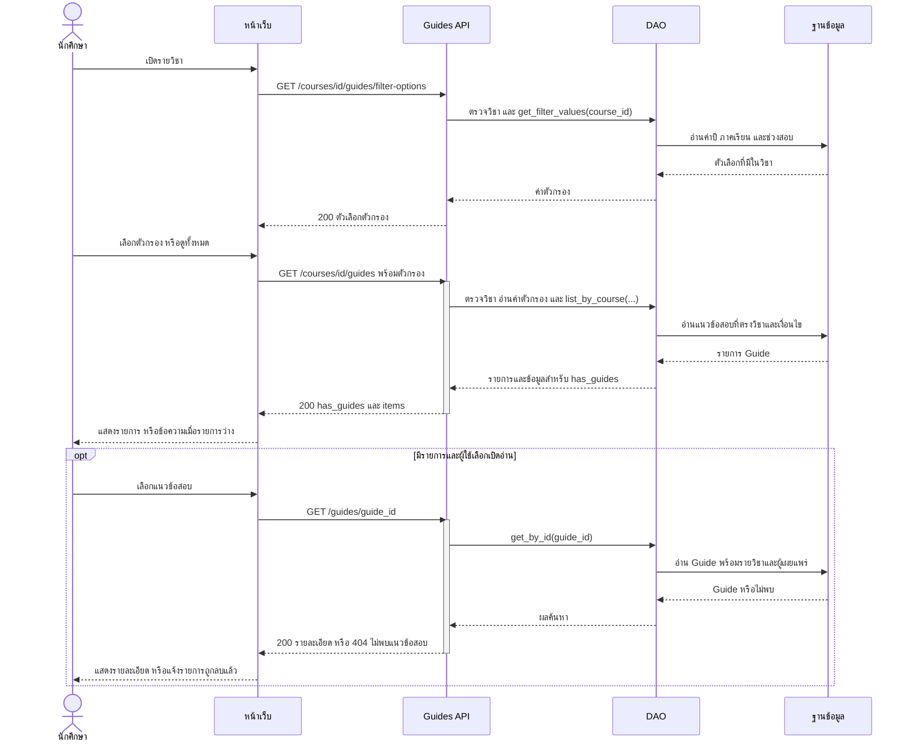

# Task37 U3 Sequence Diagram รายการและหน้าอ่านแนวข้อสอบ

ระบบลงทะเบียน Guide Router และเชื่อมหน้าเว็บกับ API แล้ว แผนภาพนี้แสดงเส้นทาง API ที่ใช้งานจริง ผ่าน Node proxy และ ReadGuideService ไม่ใช้เส้นทางข้อมูลตัวอย่างใน browser

ภาพใช้ระดับหน้าที่เพื่อให้อธิบายได้ง่าย: หน้าจอรวม JavaScript และ API client ส่วน API รวม Router กับ Service ภายใน Backend คำขอจาก Browser ยังผ่าน Node proxy และตรวจ Login ตามโค้ดจริง แต่ไม่แยกเป็น lifeline ในภาพ และ DAO ที่รวมไว้หมายถึง DAO หลายคลาสตามตารางอ้างอิง ชื่อ path บนลูกศรใช้ backend endpoint ยกเว้น U5 ที่ทั้งสองชั้นใช้ path เดียวกัน รายละเอียด validation และ error อยู่ในคำอธิบายประกอบ

## ดูรายการ กรอง และเปิดอ่านแนวข้อสอบ

เมื่อเปลี่ยนหรือล้างตัวกรอง หน้าเว็บเรียก API รายการใหม่ เลือกกรองได้เฉพาะ `academic_year`, `semester` และ `exam_period` เมื่อเลือกทั้งหมดจะละ query นั้น ไม่มีตัวกรองผู้สอนตามขอบเขตปัจจุบัน

`has_guides=false` หมายถึงวิชานี้ยังไม่มีแนวข้อสอบ ส่วน `has_guides=true` แต่ `items=[]` หมายถึงมีแนวข้อสอบแต่ไม่ตรงตัวกรอง หากผู้ใช้เลือกรายการที่ถูกลบหลังโหลดรายการแล้ว หน้าอ่านตอบว่าไม่พบรายการ

DAO ในภาพรวม `CourseDAO` สำหรับตรวจวิชาและ `ReadGuideDAO` สำหรับอ่านแนวข้อสอบ Backend DTO ยังมี `course.instructor_names` แต่หน้าอ่านปัจจุบันไม่แสดงผู้สอน

## ข้อผิดพลาดและขอบเขต

| กรณี | Response |
|---|---|
| Session ใช้ไม่ได้ | `401 error.code=AUTH_REQUIRED` |
| path/query ผิด หรือส่ง query ที่ไม่รองรับ | `422 error.code=INVALID_PARAMETERS` |
| รายวิชาไม่พบ | `404 error.code=COURSE_NOT_FOUND` |
| แนวข้อสอบไม่พบ | `404 error.code=GUIDE_NOT_FOUND` |
| ข้อผิดพลาดภายในที่ GuideApiRoute จัดการ | `500 error.code=INTERNAL_ERROR` |
| Proxy ติดต่อ backend ไม่ได้หรือ timeout | `502` จาก proxy |

การอ่านไม่ commit หรือเปลี่ยนข้อมูลในฐานข้อมูล ชื่อผู้เผยแพร่ใช้ helper ร่วมกับ U4 ไม่ได้ประกอบชื่อคนละกติกาในแต่ละหน้า

## ไฟล์อ้างอิง

- [Guide API spec](task35-guide-api.md), [Guide Entity และ ER](task36-db-er-entity-dao.md)
- [choose-courses.js](../../../frontend/public/js/choose-courses.js), [read-courses.js](../../../frontend/public/js/read-courses.js), [GuideApi](../../../frontend/public/js/guide-api.js) และ [proxy](../../../frontend/src/server.js)
- [Guide Router](../../../backend/app/routers/guides.py), [GuideApiRoute](../../../backend/app/routers/guide_errors.py), [ReadGuideService](../../../backend/app/services/read_guide.py) และ [ReadGuideDAO](../../../backend/app/dao/read_guide_dao.py)
