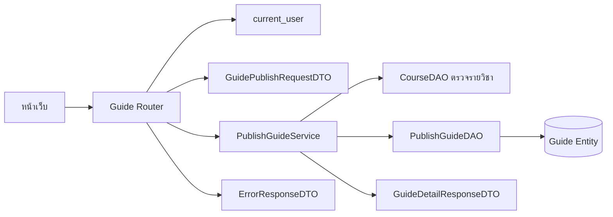

# Task52: API เผยแพร่แนวข้อสอบและ DTO ตรวจข้อมูล

## ขอบเขต

เอกสารนี้กำหนดสัญญา API สำหรับเผยแพร่แนวข้อสอบตาม U4 และ Task50 โดยอ้างอิง FastAPI, Pydantic และรูปแบบชั้น Router, Service, DAO ที่มีใน Backend ปัจจุบัน การบันทึกข้อมูลจริงเป็นงาน Task56 และ Task57

## API ที่เสนอ

### `POST /guides`

สร้างแนวข้อสอบหนึ่งรายการสำหรับรายวิชาที่มีอยู่ ผู้เรียกต้องส่ง Bearer token ที่ยังใช้ได้ ระบบใช้บัญชีจาก token เป็นเจ้าของรายการ

#### Request

```http
POST /guides
Authorization: Bearer <access_token>
Content-Type: application/json
```

```json
{
  "course_id": 1,
  "title": "แนวข้อสอบปลายภาค",
  "academic_year": 2568,
  "semester": 1,
  "exam_period": "final",
  "topics": "การเรียงลำดับและกราฟ",
  "exam_format": "mixed",
  "objective_count": 20,
  "subjective_count": 3,
  "additional_advice": "ทบทวนการวิเคราะห์ความซับซ้อน"
}
```

| ฟิลด์ | ชนิด | กติกา |
|---|---|---|
| `course_id` | integer | ต้องมากกว่า 0 และต้องตรงกับรายวิชาในระบบ |
| `title` | string | บังคับ ห้ามเป็นค่าว่างหรือมีแต่ช่องว่าง ความยาวไม่เกิน 200 ตัวอักษรตาม Entity |
| `academic_year` | integer | บังคับ เป็นปี พ.ศ. และต้องอยู่ในชุดปีที่ระบบอนุญาต ซึ่งต้องกำหนดแหล่งข้อมูลร่วมกันก่อนทำ Task57 |
| `semester` | integer | บังคับ รับ `1`, `2`, `3` โดย `3` หมายถึงภาคฤดูร้อนตาม API อ่านเดิม |
| `exam_period` | string | บังคับ รับ `midterm` หรือ `final` ตาม API อ่านเดิม |
| `topics` | string | บังคับ ห้ามเป็นค่าว่างหรือมีแต่ช่องว่าง ความยาวไม่เกิน 2,000 ตัวอักษรตาม Entity |
| `exam_format` | string | บังคับ รูปแบบค่าต้องตกลงให้ตรงกับฟอร์มและ DTO อ่านเดิมก่อนทำ Task57 |
| `objective_count` | integer หรือ null | จำนวนข้อปรนัย ถ้าระบุให้มากกว่า 0 |
| `subjective_count` | integer หรือ null | จำนวนข้ออัตนัย ถ้าระบุให้มากกว่า 0 |
| `additional_advice` | string หรือ null | ไม่บังคับ ความยาวไม่เกิน 2,000 ตัวอักษรตาม Entity |

ไม่รับ `publisher_id` จาก Request เพราะผู้ใช้ไม่ควรกำหนดเจ้าของรายการเอง ชื่อผู้สอนก็ไม่รับจากฟอร์ม โดยอ่านจากข้อมูลรายวิชาในระบบ

> รูปแบบ Request ข้างต้นสอดคล้องกับ Entity ปัจจุบัน ซึ่งเก็บจำนวนข้อปรนัยและอัตนัยแยกกัน และเก็บรูปแบบข้อสอบเป็นค่าเดียว หากทีมยืนยันตาม Task50 ว่าฟอร์มส่งจำนวนข้อรวมและเลือกรูปแบบได้หลายค่า ต้องปรับ Entity หรือกำหนดวิธีแปลงข้อมูลก่อนล็อกสัญญานี้

#### ผลสำเร็จ

ตอบ `201 Created` เมื่อสร้างรายการสำเร็จ โดย Response ใช้โครงสร้างรายละเอียดที่อ่านได้จาก `GET /guides/{guide_id}` และมี `id` ของรายการที่สร้าง

```json
{
  "id": 42,
  "title": "แนวข้อสอบปลายภาค",
  "academic_year": 2568,
  "semester": 1,
  "exam_period": "final",
  "publisher_name": "ชื่อผู้เผยแพร่",
  "course": {
    "id": 1,
    "course_code": "CS261",
    "course_name": "โครงสร้างข้อมูล",
    "instructor_names": "ชื่อผู้สอนจากข้อมูลรายวิชา"
  },
  "topics": "การเรียงลำดับและกราฟ",
  "exam_format": "mixed",
  "objective_count": 20,
  "subjective_count": 3,
  "additional_advice": "ทบทวนการวิเคราะห์ความซับซ้อน"
}
```

Response DTO ควรใช้ `GuideDetailResponseDTO` ที่มีอยู่ เพื่อให้หน้าสำเร็จสามารถเปิดหน้ารายละเอียดด้วย ID ที่ได้

## ข้อผิดพลาด

ใช้โครงสร้าง Error DTO เดียวกับ API อ่านแนวข้อสอบ (`ErrorResponseDTO`) เพื่อให้รูปแบบข้อผิดพลาดสม่ำเสมอ

```json
{
  "error": {
    "code": "INVALID_PARAMETERS",
    "message": "ข้อมูลสำหรับเผยแพร่ไม่ถูกต้อง",
    "fields": [
      {
        "field": "title",
        "message": "ต้องระบุชื่อแนวข้อสอบ"
      }
    ]
  }
}
```

| HTTP | Code ที่เสนอ | เงื่อนไข |
|---|---|---|
| `401` | `AUTH_REQUIRED` | ไม่มี token, token ไม่ถูกต้อง หรือหมดอายุ |
| `404` | `COURSE_NOT_FOUND` | ไม่พบ `course_id` ในระบบ |
| `422` | `INVALID_PARAMETERS` | ฟิลด์บังคับหายไป รูปแบบข้อมูลผิด หรือค่าอยู่นอกกติกา |
| `500` | `INTERNAL_ERROR` | เกิดข้อผิดพลาดระหว่างบันทึก ระบบต้องไม่ตอบว่าสำเร็จ |

กรณีบันทึกล้มเหลวต้อง rollback transaction เพื่อไม่ให้เกิดรายการบางส่วน รายละเอียดการควบคุม transaction และ DAO เป็นขอบเขตของ Task56/57

## DTO ที่เสนอ

| DTO | หน้าที่ | ข้อมูลหลัก |
|---|---|---|
| `GuidePublishRequestDTO` | ตรวจข้อมูลจากผู้เรียก | ฟิลด์ Request ตามตารางด้านบน ไม่มี `publisher_id` |
| `GuideDetailResponseDTO` | ส่งข้อมูลที่สร้างกลับไปให้หน้าเว็บ | ใช้ DTO รายละเอียดเดิม เพื่อเปิดหน้ารายการที่เพิ่งเผยแพร่ |
| `ErrorResponseDTO` | ส่งข้อผิดพลาดในรูปแบบเดียวกัน | `code`, `message`, `fields` |

Request DTO ควรตรวจค่าที่ขอบเขต API ด้วย Pydantic เช่น ชนิดข้อมูล ค่าบังคับ ความยาว และค่าตัวเลือก ส่วนการตรวจว่ารายวิชามีอยู่และการกำหนดผู้เผยแพร่ต้องอาศัยข้อมูลในระบบ จึงเป็นหน้าที่ Service หลัง Router ตรวจตัวตนแล้ว

## การแบ่งหน้าที่ของโค้ด

| ส่วน | หน้าที่ในเส้นทางเผยแพร่ |
|---|---|
| `backend/app/routers/guides.py` | ประกาศ `POST /guides`, รับ Request DTO, ใช้ `current_user` และเรียก Service |
| `backend/app/schemas/guides.py` | ประกาศ Request, Response และ Error DTO ด้วย Pydantic |
| `backend/app/services/publish_guide.py` | ตรวจเงื่อนไขที่ต้องอ่านข้อมูลระบบ กำหนดเจ้าของจากผู้ใช้ปัจจุบัน และประสานการสร้างรายการ |
| `backend/app/dao/publish_guide_dao.py` | บันทึก Entity ผ่าน SQLAlchemy session ตามรูปแบบที่ทีมเลือกใน Task56 |
| `backend/app/models/guide.py` | ใช้ Entity `Guide` เดิม หากกติกาฟอร์มกับโครงสร้างข้อมูลไม่ขัดกัน |

Service และ DAO ควรเป็นคลาสเมื่อมี dependency และหน้าที่ต่อเนื่องตามรูปแบบเดิมของ `ReadGuideService` และ `ReadGuideDAO` ไม่เพิ่มคลาสแยกสำหรับการแปลงค่าที่มีผู้เรียกเพียงจุดเดียว

## แผนภาพความสัมพันธ์



แผนภาพนี้แสดงเฉพาะส่วนที่รับผิดชอบ API และ DTO ลำดับการเรียกเมธอดระหว่าง UI, API, DAO และฐานข้อมูลเป็นงาน Task53

## จุดที่ต้องตกลงก่อน Task57

1. Task50 ระบุ Checkbox ที่เลือกรูปแบบข้อสอบได้หลายค่า แต่ Entity และ `GuideDetailResponseDTO` ปัจจุบันเก็บ `exam_format` เป็นค่าเดียว (`objective`, `subjective`, `mixed`) และไม่รองรับ `other` ต้องเลือกว่าจะปรับสัญญาฟอร์มหรือปรับ Entity/API อ่าน
2. Task50 ระบุจำนวนข้อรวม แต่ Entity เก็บ `objective_count` และ `subjective_count` แยกกัน ต้องให้ฟอร์มส่งสองค่า หรือกำหนดวิธีเก็บจำนวนรวม
3. Task50 ให้เลือกปีจากชุดค่าที่ระบบเตรียมไว้ แต่ยังไม่พบแหล่งค่าที่อนุญาตใน Backend ต้องระบุชุดข้อมูลหรือกติกาสร้างชุดปี
4. `POST /guides` เป็นเส้นทางที่เสนอให้เข้ากับ API อ่านเดิม ทีมควรยืนยันก่อนเริ่ม Task57

## เกณฑ์ตรวจรับเอกสาร

- มีวิธีเรียก API, Request/Response ตัวอย่าง และรายการข้อผิดพลาด
- Request ไม่เปิดให้กำหนดผู้เผยแพร่หรือชื่อผู้สอน
- ระบุชัดว่า DTO ตรวจข้อมูลรูปแบบใด และ Service ตรวจข้อมูลที่ต้องอ่านจากระบบ
- แผนภาพแสดง Router, Auth, DTO และ Service โดยไม่ลงรายละเอียด Sequence ของ Task53
- จุดที่ Task50, Entity และ DTO อ่านเดิมยังไม่ตรงกันถูกระบุไว้ก่อนเริ่มพัฒนา
