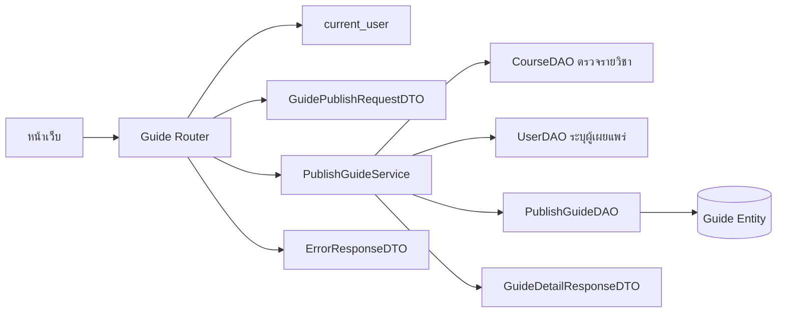

# Task52: API เผยแพร่แนวข้อสอบและ DTO ตรวจข้อมูล

## ขอบเขต

เอกสารนี้อธิบาย API เผยแพร่แนวข้อสอบที่ใช้งานแล้ว Router รับข้อมูลและตรวจ Login ส่วน PublishGuideService ตรวจรายวิชา กำหนดเจ้าของ และควบคุม transaction ผ่าน DAO

## API ที่ใช้งาน

### `POST /guides`

สร้างแนวข้อสอบหนึ่งรายการสำหรับรายวิชาที่มีอยู่ ผู้เรียกต้องส่ง Bearer token ที่ยังใช้ได้ ระบบใช้บัญชีจาก token เป็นเจ้าของรายการ

#### Request

```http
POST /guides
Authorization: Bearer <access_token>
Content-Type: application/json
```

```json
{
  "course_id": 1,
  "title": "แนวข้อสอบปลายภาค",
  "academic_year": 2568,
  "semester": 1,
  "exam_period": "final",
  "topics": "การเรียงลำดับและกราฟ",
  "exam_format": "mixed",
  "objective_count": 20,
  "subjective_count": 3,
  "additional_advice": "ทบทวนการวิเคราะห์ความซับซ้อน"
}
```

| ฟิลด์ | ชนิด | กติกา |
|---|---|---|
| `course_id` | integer | ต้องมากกว่า 0 และต้องตรงกับรายวิชาในระบบ |
| `title` | string | บังคับ ห้ามเป็นค่าว่างหรือมีแต่ช่องว่าง ความยาวไม่เกิน 200 ตัวอักษรตาม Entity |
| `academic_year` | integer | บังคับ เป็นหนึ่งใน 2566, 2567, 2568, 2569 ตาม AcademicYear ใน schema |
| `semester` | integer | บังคับ รับ `1`, `2`, `3` โดย `3` หมายถึงภาคฤดูร้อนตาม API อ่านเดิม |
| `exam_period` | string | บังคับ รับ `midterm` หรือ `final` ตาม API อ่านเดิม |
| `topics` | string | บังคับ ห้ามเป็นค่าว่างหรือมีแต่ช่องว่าง ความยาวไม่เกิน 2,000 ตัวอักษรตาม Entity |
| `exam_format` | string | บังคับ เลือกจาก Dropdown ค่า `objective`, `subjective` หรือ `mixed` |
| `objective_count` | integer หรือ null | จำนวนข้อปรนัย ถ้าระบุให้มากกว่า 0 เก็บตาม Entity เดิม |
| `subjective_count` | integer หรือ null | จำนวนข้ออัตนัย ถ้าระบุให้มากกว่า 0 เก็บตาม Entity เดิม |
| `additional_advice` | string หรือ null | ไม่บังคับ ความยาวไม่เกิน 2,000 ตัวอักษรตาม Entity |

ไม่รับ `publisher_id` จาก Request เพราะผู้ใช้ไม่ควรกำหนดเจ้าของรายการเอง ชื่อผู้สอนก็ไม่รับจากฟอร์ม โดยอ่านจากข้อมูลรายวิชาในระบบ

รูปแบบ Request นี้ตรงกับ Entity ปัจจุบัน โดย Dropdown เลือก `exam_format` ได้หนึ่งค่าและไม่มีตัวเลือก `other` ส่วนจำนวนข้อปรนัยและอัตนัยเก็บแยกใน `objective_count` และ `subjective_count`

#### ผลสำเร็จ

ตอบ `201 Created` เมื่อสร้างรายการสำเร็จ โดย Response ใช้โครงสร้างรายละเอียดที่อ่านได้จาก `GET /guides/{guide_id}` และมี `id` ของรายการที่สร้าง

```json
{
  "id": 42,
  "title": "แนวข้อสอบปลายภาค",
  "academic_year": 2568,
  "semester": 1,
  "exam_period": "final",
  "publisher_name": "ชื่อผู้เผยแพร่",
  "course": {
    "id": 1,
    "course_code": "CS261",
    "course_name": "INTRODUCTION TO SOFTWARE ENGINEERING",
    "instructor_names": null
  },
  "topics": "การเรียงลำดับและกราฟ",
  "exam_format": "mixed",
  "objective_count": 20,
  "subjective_count": 3,
  "additional_advice": "ทบทวนการวิเคราะห์ความซับซ้อน"
}
```

Response ใช้ GuideDetailResponseDTO หน้าเว็บจึงเปิดรายละเอียดด้วย ID ที่สร้างได้ทันที

## ข้อผิดพลาด

ใช้โครงสร้าง Error DTO เดียวกับ API อ่านแนวข้อสอบ (`ErrorResponseDTO`) เพื่อให้รูปแบบข้อผิดพลาดสม่ำเสมอ

```json
{
  "error": {
    "code": "INVALID_PARAMETERS",
    "message": "ข้อมูลสำหรับเผยแพร่ไม่ถูกต้อง",
    "fields": [
      {
        "field": "title",
        "message": "ต้องระบุชื่อแนวข้อสอบ"
      }
    ]
  }
}
```

| HTTP | error.code | เงื่อนไข |
|---|---|---|
| `401` | `AUTH_REQUIRED` | ไม่มี token, token ไม่ถูกต้อง หรือหมดอายุ |
| `404` | `COURSE_NOT_FOUND` | ไม่พบ course_id หรือรหัสวิชาอยู่นอกขอบเขต CS |
| `422` | `INVALID_PARAMETERS` | ฟิลด์บังคับหายไป รูปแบบข้อมูลผิด หรือค่าอยู่นอกกติกา |
| `500` | `INTERNAL_ERROR` | เกิดข้อผิดพลาดระหว่างบันทึก ระบบต้องไม่ตอบว่าสำเร็จ |

กรณีบันทึกล้มเหลวต้อง rollback transaction เพื่อไม่ให้เกิดรายการบางส่วน รายละเอียดการควบคุม transaction และ DAO เป็นขอบเขตของ Task56/57

## DTO ที่ใช้งาน

| DTO | หน้าที่ | ข้อมูลหลัก |
|---|---|---|
| `GuidePublishRequestDTO` | ตรวจข้อมูลจากผู้เรียก | ฟิลด์ Request ตามตารางด้านบน ไม่มี `publisher_id` |
| `GuideDetailResponseDTO` | ส่งข้อมูลที่สร้างกลับไปให้หน้าเว็บ | ใช้ DTO รายละเอียดเดิม เพื่อเปิดหน้ารายการที่เพิ่งเผยแพร่ |
| `ErrorResponseDTO` | ส่งข้อผิดพลาดในรูปแบบเดียวกัน | `code`, `message`, `fields` |

Pydantic ตรวจชนิดข้อมูล ฟิลด์บังคับ ความยาว และตัวเลือกที่ boundary ส่วน Service ตรวจรายวิชาและกำหนดผู้เผยแพร่จากบัญชีที่ Login แล้ว Request ใช้ strict integer สำหรับ course_id และจำนวนข้อ พร้อม extra=forbid เพื่อปฏิเสธ field ที่ไม่ได้กำหนด

## การแบ่งหน้าที่ของโค้ด

| ส่วน | หน้าที่ในเส้นทางเผยแพร่ |
|---|---|
| `backend/app/routers/guides.py` | ประกาศ `POST /guides`, รับ Request DTO, ใช้ `current_user` และเรียก Service |
| `backend/app/schemas/guides.py` | ประกาศ Request, Response และ Error DTO ด้วย Pydantic |
| `backend/app/services/publish_guide.py` | ตรวจเงื่อนไขที่ต้องอ่านข้อมูลระบบ กำหนดเจ้าของจากผู้ใช้ปัจจุบัน และประสานการสร้างรายการ |
| `backend/app/dao/publish_guide_dao.py` | บันทึก Entity ผ่าน SQLAlchemy session ตามรูปแบบที่ทีมเลือกใน Task56 |
| `backend/app/models/guide.py` | Guide Entity ที่ใช้ร่วมกับการอ่าน แก้ไข และลบ |

Service รับ Session และ DAO จาก dependencies.py ส่วน DAO ทำ add/flush โดยไม่ commit เอง

## แผนภาพความสัมพันธ์



แผนภาพนี้แสดงส่วนประกอบ API และ DTO ไม่ใช่ Sequence ดูลำดับ Browser, Node proxy, API, Service, DAO และ transaction ใน [Task53](task53-publish-guide-sequence-diagram.md)

## สถานะที่ implement แล้ว

1. Request schema ใช้ AcademicYear ร่วมกันสำหรับปี 2566–2569
2. Backend ลงทะเบียน `POST /guides` แล้ว ส่วน Browser เรียก `POST /api/guides` ผ่าน Node proxy
3. PublishGuideService เตรียม response ก่อน commit และเป็นผู้คุม transaction ของ User กับ Guide ร่วมกัน DAO ไม่ commit เอง

## เกณฑ์ตรวจรับเอกสาร

- มีวิธีเรียก API, Request/Response ตัวอย่าง และรายการข้อผิดพลาด
- Request ไม่เปิดให้กำหนดผู้เผยแพร่หรือชื่อผู้สอน
- ระบุชัดว่า DTO ตรวจข้อมูลรูปแบบใด และ Service ตรวจข้อมูลที่ต้องอ่านจากระบบ
- แผนภาพแสดง Router, Auth, DTO และ Service โดยไม่ลงรายละเอียด Sequence ของ Task53
- รูปแบบข้อสอบ จำนวนข้อ และผู้สอนตรงกับ Dropdown และ Entity ที่มีอยู่
- แยก contract ของ backend ออกจาก Node proxy และระบุข้อจำกัดของผลที่ยืนยันไม่ได้

หาก network timeout หลังส่งฟอร์ม ไม่สามารถสรุปว่าฐานข้อมูล rollback แล้ว หน้าเว็บแจ้งให้ตรวจรายการก่อนส่งซ้ำ ส่วนปีที่อนุญาตและรูปแบบข้อสอบใช้ตาม schema ไม่สร้างตัวเลือกใหม่จาก request
