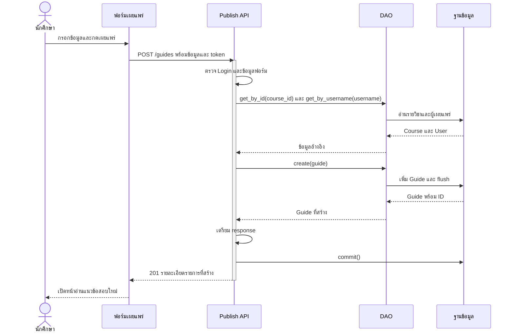

# Task53 U4 Sequence Diagram เผยแพร่แนวข้อสอบ

แผนภาพแสดงเส้นทางเผยแพร่ที่ใช้งานจริง ใช้ Guide, Course และ User เดิม ไม่มีการเพิ่มตารางสำหรับการเผยแพร่ และไม่มีรูปแบบข้อสอบอื่น ๆ ในตัวเลือกปัจจุบัน

ภาพใช้ระดับหน้าที่เพื่อให้อธิบายได้ง่าย: หน้าจอรวม JavaScript และ API client ส่วน API รวม Router กับ Service ภายใน Backend คำขอจาก Browser ยังผ่าน Node proxy และตรวจ Login ตามโค้ดจริง แต่ไม่แยกเป็น lifeline ในภาพ และ DAO ที่รวมไว้หมายถึง DAO หลายคลาสตามตารางอ้างอิง ชื่อ path บนลูกศรใช้ backend endpoint ยกเว้น U5 ที่ทั้งสองชั้นใช้ path เดียวกัน รายละเอียด validation และ error อยู่ในคำอธิบายประกอบ

## เผยแพร่รายการ

## กติกาที่ใช้อธิบายภาพ

- Browser เรียก `/api/guides` ที่ Node แต่ backend รับ `POST /guides` ไม่ใช่ endpoint เดียวกันทั้งสองชั้น
- เจ้าของมาจาก Session ที่ตรวจแล้วและ map ไปยัง `users.id` ไม่รับ `publisher_id` จากฟอร์ม ถ้าส่ง field เกินมา Request DTO ปฏิเสธ
- ภาพแสดงกรณีสำเร็จที่พบ User จาก Login แล้ว หากยังไม่มี User ในฐานข้อมูล PublishGuideService เรียก get_or_create_from_tu_profile ก่อนสร้าง Guide
- Service เป็นผู้ commit/rollback ส่วน DAO ทำ add/flush การสร้าง User ที่ยังไม่มีและ Guide อยู่ใน transaction เดียวกัน
- ปีที่รับสำหรับสร้างรายการคือ 2566–2569 ภาคเรียนเป็น 1/2/3 ช่วงสอบเป็น midterm/final รูปแบบเป็น objective/subjective/mixed
- จำนวนข้อเว้นได้ หากระบุต้องเป็น integer มากกว่า 0 และต้องไม่กรอกจำนวนของรูปแบบที่ไม่ได้เลือก
- ความล้มเหลวระหว่างส่ง request หรือรับ response อาจยืนยันผลบันทึกไม่ได้ UI แจ้งให้ตรวจรายการก่อนส่งซ้ำ ไม่อธิบายว่า network timeout แปลว่า rollback สำเร็จเสมอ
- หาก proxy ติดต่อ backend ไม่ได้จะตอบ `502` ซึ่งต่างจาก `500 INTERNAL_ERROR` ที่ backend ส่งกลับ

## เมธอดและไฟล์อ้างอิง

| ชั้น | หน้าที่และเมธอด |
|---|---|
| [upload.js](../../../frontend/public/js/upload.js) | อ่านและตรวจฟอร์ม ส่งผ่าน GuideApi แล้วเปิดรายการที่สร้าง |
| [GuideApi](../../../frontend/public/js/guide-api.js) | `publish` และ `request` จัดการ token, response และกรณียืนยันผลไม่ได้ |
| [Node proxy](../../../frontend/src/server.js) | ส่ง POST ไป path ที่กำหนดไว้ และส่งต่อผล HTTP |
| [Guide Router](../../../backend/app/routers/guides.py) | `publish_guide` และ Request DTO ที่ boundary |
| [PublishGuideService](../../../backend/app/services/publish_guide.py) | `publish` ตรวจวิชา กำหนดเจ้าของ เตรียม DTO และคุม transaction |
| [PublishGuideDAO](../../../backend/app/dao/publish_guide_dao.py) | `create` เพิ่ม Guide และ flush |

ดู [API และ DTO ของ Task52](task52-publish-guide-api-spec.md), [UserDAO](../../../backend/app/dao/user_dao.py) และ [ER ของ Guide](../../U3/design/task36-db-er-entity-dao.md)
