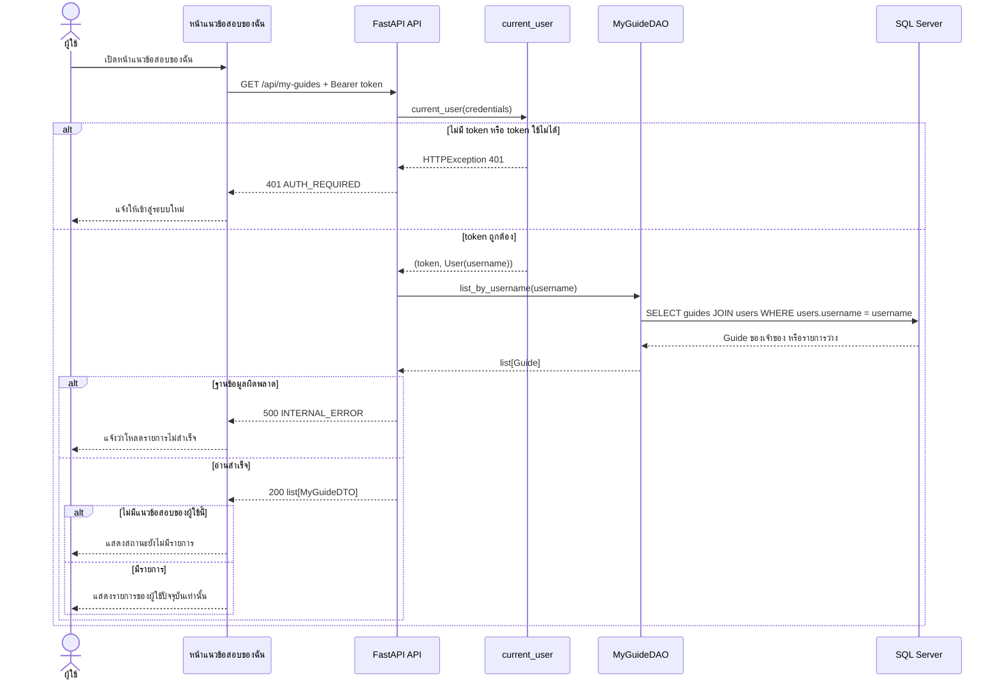

# Task66: U5 — Sequence Diagram รายการ แก้ไข และลบแนวข้อสอบ

แผนภาพนี้อธิบาย flow เป้าหมายของหน้าแนวข้อสอบของฉัน ตั้งแต่ผู้ใช้ผ่านการตรวจ Login จนถึง UI, API, DAO และฐานข้อมูลทำงานร่วมกัน ใช้ Entity/ER เดิม ได้แก่ `Guide`, `User` และ `Course` โดยไม่เพิ่มหรือเปลี่ยนตาราง

> สถานะปัจจุบัน: API รายการและ DAO ลบอยู่ใน branch ของ Task71/Task70 ตามลำดับ ส่วน API/DAO แก้ไขยังเป็น flow ที่เสนอสำหรับ implementation ถัดไป ปัจจุบัน `shared-courses.html`/`shared-courses.js` ยังใช้ข้อมูลตัวอย่างใน browser `localStorage` จึงยังไม่ได้ต่อ flow เป้าหมายนี้เข้ากับ backend

## 1. ดูรายการแนวข้อสอบของฉัน



## 2. แก้ไขแนวข้อสอบของเจ้าของ

```mermaid
sequenceDiagram
    actor User as ผู้ใช้
    participant UI as หน้าแนวข้อสอบของฉัน/ฟอร์มแก้ไข
    participant API as FastAPI API
    participant Auth as current_user
    participant UDAO as UserDAO (เมธอดเดิม)
    participant DAO as UpdateOwnedGuideDAO (เมธอดที่เสนอ)
    participant DB as SQL Server

    User->>UI: เลือกรายการและแก้ข้อมูล
    UI-->>User: แสดงฟอร์มพร้อมข้อมูลเดิม
    User->>UI: บันทึกการแก้ไข
    UI->>API: PUT /api/my-guides/{guide_id} + Bearer token + payload
    API->>Auth: current_user(credentials)
    alt ไม่มี token หรือ token ใช้ไม่ได้
        Auth-->>API: HTTPException 401
        API-->>UI: 401 AUTH_REQUIRED
        UI-->>User: แจ้งให้เข้าสู่ระบบใหม่
    else token ถูกต้อง
        Auth-->>API: (token, User(username))
        API->>API: ตรวจ payload ตามกติกา U5
        alt payload ไม่ถูกต้อง
            API-->>UI: 422 VALIDATION_ERROR
            UI-->>User: แสดงข้อผิดพลาด; ข้อมูลเดิมไม่เปลี่ยน
        else payload ถูกต้อง
            API->>UDAO: get_by_username(username)
            UDAO->>DB: SELECT users WHERE username = username
            DB-->>UDAO: User row หรือ None
            UDAO-->>API: User หรือ None
            alt ไม่มี User row
                API-->>UI: 404 GUIDE_NOT_FOUND
                UI-->>User: แจ้งว่าไม่พบรายการหรือไม่มีสิทธิ์
            else พบ User row
                API->>DAO: update_owned(guide_id, db_user.id, payload)
                DAO->>DB: UPDATE guides WHERE id = guide_id AND publisher_id = db_user.id
                alt ไม่พบรายการหรือไม่ใช่เจ้าของ
                    DB-->>DAO: 0 rows affected
                    DAO-->>API: None / False
                    API-->>UI: 404 GUIDE_NOT_FOUND
                    UI-->>User: แจ้งว่าไม่พบรายการหรือไม่มีสิทธิ์
                else แก้ไขสำเร็จ
                    DB-->>DAO: 1 row updated
                    DAO-->>API: Guide ที่แก้ไขแล้ว
                    API->>DB: COMMIT transaction
                    API-->>UI: 200 MyGuideDTO ล่าสุด
                    UI-->>User: แจ้งสำเร็จและปรับปรุงรายการ
                end
            end
        end
    end

    opt ฐานข้อมูลหรือ commit ผิดพลาด
        API->>DB: ROLLBACK transaction
        API-->>UI: 500 INTERNAL_ERROR
        UI-->>User: แจ้งไม่สำเร็จ; คงข้อมูลเดิม
    end
```

## 3. ลบแนวข้อสอบของเจ้าของ

```mermaid
sequenceDiagram
    actor User as ผู้ใช้
    participant UI as หน้าแนวข้อสอบของฉัน/กล่องยืนยัน
    participant API as FastAPI API
    participant Auth as current_user
    participant UDAO as UserDAO (เมธอดเดิม)
    participant DAO as DeleteOwnedGuideDAO
    participant DB as SQL Server

    User->>UI: กดลบรายการ
    UI-->>User: แสดงกล่องยืนยัน
    alt ยกเลิก
        User->>UI: ยกเลิกการลบ
        UI-->>User: ปิดกล่อง; ไม่ส่ง API request; รายการยังอยู่
    else ยืนยันการลบ
        User->>UI: ยืนยัน
        UI->>API: DELETE /api/my-guides/{guide_id} + Bearer token
        API->>Auth: current_user(credentials)
        alt ไม่มี token หรือ token ใช้ไม่ได้
            Auth-->>API: HTTPException 401
            API-->>UI: 401 AUTH_REQUIRED
            UI-->>User: แจ้งให้เข้าสู่ระบบใหม่
        else token ถูกต้อง
            Auth-->>API: (token, User(username))
            API->>UDAO: get_by_username(username)
            UDAO->>DB: SELECT users WHERE username = username
            DB-->>UDAO: User row หรือ None
            UDAO-->>API: User หรือ None
            alt ไม่มี User row
                API-->>UI: 404 GUIDE_NOT_FOUND
                UI-->>User: แจ้งว่าไม่พบรายการหรือไม่มีสิทธิ์
            else พบ User row
                API->>DAO: delete_owned(guide_id, db_user.id)
                DAO->>DB: DELETE guides WHERE id = guide_id AND publisher_id = db_user.id
                alt ไม่พบรายการหรือไม่ใช่เจ้าของ
                    DB-->>DAO: 0 rows affected
                    DAO-->>API: False
                    API-->>UI: 404 GUIDE_NOT_FOUND
                    UI-->>User: แจ้งว่าไม่พบรายการหรือไม่มีสิทธิ์
                else ลบสำเร็จ
                    DB-->>DAO: 1 row deleted
                    DAO-->>API: True
                    API->>DB: COMMIT transaction
                    API-->>UI: 204 No Content
                    UI-->>User: แจ้งสำเร็จและเอารายการออกจากหน้า
                end
            end
        end
    end

    opt ฐานข้อมูลหรือ commit ผิดพลาด
        API->>DB: ROLLBACK transaction
        API-->>UI: 500 INTERNAL_ERROR
        UI-->>User: แจ้งไม่สำเร็จ; รายการไม่แสดงเป็นว่าลบแล้ว
    end
```

## 4. Entity/ER ที่ใช้งาน

- `Guide` (`guides`) มี `publisher_id` เป็น Foreign Key ไป `User.id` และ `course_id` เป็น Foreign Key ไป `Course.id`
- `User` (`users`) ระบุตัวเจ้าของผ่าน username ที่ Login ยืนยันแล้ว และใช้ `users.id` ในเงื่อนไขแก้ไข/ลบ
- `Course` (`courses`) ให้รหัสวิชา ชื่อวิชา และชื่อผู้สอนสำหรับ DTO
- ไม่เพิ่ม Entity, table, column หรือ relationship สำหรับ Task66

ดูแบบจำลองเดิมได้ที่ [U3 Entity/DAO](U3_%20DB%20ER%20Entity%20DAO.md) และ [U1 User Entity/DAO](../U1/U1_%20DB%20ER%20Entity%20DAO.md)

## 5. DAO methods ใน flow นี้

Task66 เป็นงานออกแบบเอกสาร จึงไม่มีการเพิ่ม DAO method หรือแก้ code/Entity ใน branch นี้ รายการด้านล่างจำกัดเฉพาะ DAO calls ที่จำเป็นต่อ flow ทั้งสาม:

| Flow | DAO method | สถานะ/ที่มา |
|---|---|---|
| รายการ | `MyGuideDAO.list_by_username(username)` | มีใน branch Task71; กรองผ่าน `User.username` |
| แก้ไข | `UpdateOwnedGuideDAO.update_owned(guide_id, publisher_id, payload)` | ชื่อและ contract ที่เสนอสำหรับ implementation; ยังไม่มีใน integration |
| ลบ | `DeleteOwnedGuideDAO.delete_owned(guide_id, publisher_id)` | มีใน branch Task70; คืน `True` เมื่อมีการลบหนึ่งแถว |

`UserDAO.get_by_username(username)` เป็นเมธอดเดิมที่ใช้ map ตัวตนจาก `current_user` ไปยัง `users.id`; ไม่ใช่ DAO method ใหม่ของ Task66. API ต้องใช้ `users.id` จากฐานข้อมูลเพื่อเทียบ `publisher_id` และไม่ใช้ numeric ID จาก session in-memory แทน

ชื่อ endpoint และ error code ใน diagram เป็นสัญญาออกแบบสำหรับ flow U5; ส่วน flow แก้ไขและลบจะทำงานจริงเมื่อมีการ implement API routes และ transaction ตามลำดับ
