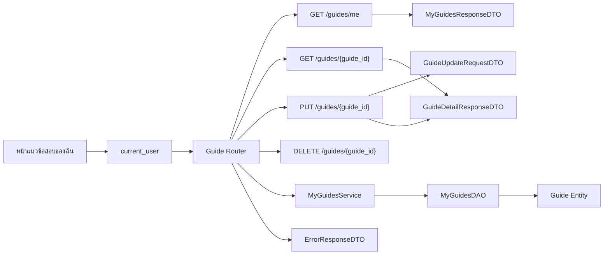

# Task65: API รายการ แก้ไข และลบแนวข้อสอบของฉัน

## ขอบเขต

เอกสารนี้กำหนด API สำหรับดูรายการแนวข้อสอบของผู้ใช้ปัจจุบัน แก้ไข และลบรายการของตนเอง อ้างอิงกติกา Task62, กรณีทดสอบใน Task67, แบบข้อมูล Guide ใน Task36 และ FastAPI/Pydantic ที่ใช้ใน Backend

Task65 ส่งมอบ API Spec, DTO Schema และแผนภาพ Router/API กับ DTO ส่วนการพัฒนา DAO และ API เป็นงาน Task68–73

## API

ทุก API ต้องส่ง Bearer token ที่ยังใช้ได้ Backend อ่านผู้ใช้จาก `current_user` และใช้ `user.id` ตรวจเจ้าของรายการ

| Method | Path | หน้าที่ | ผลสำเร็จ |
|---|---|---|---|
| `GET` | `/guides/me` | อ่านรายการของผู้ใช้ปัจจุบัน | `200 OK` |
| `GET` | `/guides/{guide_id}` | อ่านรายละเอียดรายการที่เลือก ใช้ API เดิม | `200 OK` |
| `PUT` | `/guides/{guide_id}` | แทนข้อมูลที่แก้ไขของรายการเดิม | `200 OK` |
| `DELETE` | `/guides/{guide_id}` | ลบรายการของผู้ใช้ปัจจุบัน | `204 No Content` |

ต้องประกาศ `/guides/me` ก่อน `/guides/{guide_id}` เพื่อไม่ให้ FastAPI ตีความ `me` เป็นค่า `guide_id`

## อ่านรายการของฉัน

### `GET /guides/me`

อ่านเฉพาะแนวข้อสอบที่ `publisher_id` ตรงกับผู้ใช้จาก token รายการว่างตอบ `200 OK` พร้อม `items: []`

```http
GET /guides/me
Authorization: Bearer <access_token>
```

```json
{
  "items": [
    {
      "id": 42,
      "course": {
        "id": 1,
        "course_code": "CS261",
        "course_name": "โครงสร้างข้อมูล",
        "instructor_names": "ชื่อผู้สอน"
      },
      "title": "แนวข้อสอบปลายภาค",
      "academic_year": 2568,
      "semester": 1,
      "exam_period": "final",
      "topics": "การเรียงลำดับและกราฟ",
      "exam_format": "mixed",
      "objective_count": 20,
      "subjective_count": 3,
      "publisher_name": "ชื่อผู้เผยแพร่",
      "additional_advice": null
    }
  ]
}
```

Response ใช้ `MyGuidesResponseDTO` ซึ่งมี `items` เป็นรายการ `GuideDetailResponseDTO` เพื่อให้หน้าของฉันแสดงข้อมูลที่ Task62 กำหนด และเปิดรายละเอียดรายการที่เลือกได้โดยใช้ `id`

## อ่านรายละเอียดรายการ

### `GET /guides/{guide_id}`

ใช้ API อ่านแนวข้อสอบเดิมและ `GuideDetailResponseDTO` ผู้ใช้ที่เข้าสู่ระบบแล้วอ่านรายการได้ตามสิทธิ์ของ API ปัจจุบัน หากไม่พบรายการตอบ `404 GUIDE_NOT_FOUND`

```http
GET /guides/42
Authorization: Bearer <access_token>
```

## แก้ไขรายการ

### `PUT /guides/{guide_id}`

แก้ไขข้อมูลของรายการเดิม เจ้าของต้องตรงกับผู้ใช้จาก token การแก้ไขคง `id` และ `publisher_id` เดิม และไม่สร้างรายการใหม่

```http
PUT /guides/42
Authorization: Bearer <access_token>
Content-Type: application/json
```

```json
{
  "course_id": 1,
  "title": "แนวข้อสอบปลายภาค ฉบับปรับปรุง",
  "academic_year": 2568,
  "semester": 1,
  "exam_period": "final",
  "topics": "การเรียงลำดับ กราฟ และการวิเคราะห์ความซับซ้อน",
  "exam_format": "mixed",
  "objective_count": 18,
  "subjective_count": 4,
  "additional_advice": "ฝึกทำโจทย์กราฟ"
}
```

| ฟิลด์ | ชนิด | กติกา |
|---|---|---|
| `course_id` | integer | บังคับ มากกว่า 0 และต้องมีอยู่ในระบบ |
| `title` | string | บังคับ หลังตัดช่องว่างต้องไม่ว่าง ความยาวไม่เกิน 200 ตัวอักษรตาม Entity |
| `academic_year` | integer | บังคับ ปี พ.ศ. ชุดปีที่อนุญาตต้องตรงกับฟอร์มและระบบ |
| `semester` | integer | บังคับ รับ `1`, `2` หรือ `3` |
| `exam_period` | string | บังคับ รับ `midterm` หรือ `final` |
| `topics` | string | บังคับ หลังตัดช่องว่างต้องไม่ว่าง ความยาวไม่เกิน 2,000 ตัวอักษร |
| `exam_format` | string | บังคับ เลือกหนึ่งค่าจาก `objective`, `subjective`, `mixed` |
| `objective_count` | integer หรือ null | จำนวนข้อปรนัย ตาม Entity |
| `subjective_count` | integer หรือ null | จำนวนข้ออัตนัย ตาม Entity |
| `additional_advice` | string หรือ null | ไม่บังคับ ความยาวไม่เกิน 2,000 ตัวอักษร |

ค่าจำนวนข้อที่ระบุต้องเป็นจำนวนเต็มมากกว่า 0 ส่วนที่ไม่ระบุเป็น `null` ตาม Task36 และ Entity ปัจจุบัน เมื่อเปลี่ยนรายวิชา รายการเดิมย้ายไปวิชาใหม่ ผู้สอนมาจากข้อมูลรายวิชาที่เลือก ไม่รับ `publisher_id` หรือชื่อผู้สอนจาก Request

Response ใช้ `GuideDetailResponseDTO` ที่แสดงข้อมูลล่าสุด รวมข้อมูล Course และชื่อผู้เผยแพร่

```json
{
  "id": 42,
  "title": "แนวข้อสอบปลายภาค ฉบับปรับปรุง",
  "academic_year": 2568,
  "semester": 1,
  "exam_period": "final",
  "publisher_name": "ชื่อผู้เผยแพร่",
  "course": {
    "id": 1,
    "course_code": "CS261",
    "course_name": "โครงสร้างข้อมูล",
    "instructor_names": "ชื่อผู้สอน"
  },
  "topics": "การเรียงลำดับ กราฟ และการวิเคราะห์ความซับซ้อน",
  "exam_format": "mixed",
  "objective_count": 18,
  "subjective_count": 4,
  "additional_advice": "ฝึกทำโจทย์กราฟ"
}
```

## ลบรายการ

### `DELETE /guides/{guide_id}`

เจ้าของยืนยันการลบบนหน้าเว็บก่อนส่งคำขอ เมื่อสำเร็จ API ตอบ `204 No Content` และไม่มี body หากผู้ใช้ยกเลิกการยืนยัน หน้าเว็บไม่ส่งคำขอ

```http
DELETE /guides/42
Authorization: Bearer <access_token>
```

## DTO Schema

| DTO | หน้าที่ | ฟิลด์หลัก |
|---|---|---|
| `MyGuidesResponseDTO` | คืนรายการแนวข้อสอบของฉัน | `items` |
| `GuideDetailResponseDTO` | แสดงรายละเอียดและผลหลังแก้ไข | ฟิลด์ Guide, `course`, `publisher_name` |
| `GuideUpdateRequestDTO` | ตรวจข้อมูลจากฟอร์มแก้ไข | ฟิลด์ที่แก้ไขได้ตามตาราง Request ไม่รวม `id` และ `publisher_id` |
| `ErrorResponseDTO` | คืนข้อผิดพลาดรูปแบบเดียวกัน | `error.code`, `error.message`, `error.fields` |

Pydantic ตรวจชนิดข้อมูล ค่าที่อนุญาต ความยาว และฟิลด์บังคับที่ขอบเขต API Service ตรวจว่ารายวิชาและรายการมีอยู่จริง รวมถึงสิทธิ์เจ้าของ

## ข้อผิดพลาด

| HTTP | Code | เงื่อนไข |
|---|---|---|
| `401` | `AUTH_REQUIRED` | ไม่มี token หรือ token ใช้ไม่ได้ |
| `403` | `FORBIDDEN` | ผู้ใช้ไม่ใช่เจ้าของรายการที่แก้ไขหรือลบ |
| `404` | `GUIDE_NOT_FOUND` | ไม่พบรายการ หรือรายการถูกลบแล้ว |
| `404` | `COURSE_NOT_FOUND` | ไม่พบรายวิชาที่ส่งในคำขอแก้ไข |
| `422` | `INVALID_PARAMETERS` | Path หรือ Request body ไม่ผ่านการตรวจสอบ |
| `500` | `INTERNAL_ERROR` | เกิดข้อผิดพลาดระหว่างอ่าน บันทึก หรือลบ |

ตัวอย่างข้อมูลไม่ผ่านการตรวจสอบ:

```json
{
  "error": {
    "code": "INVALID_PARAMETERS",
    "message": "ข้อมูลสำหรับแก้ไขไม่ถูกต้อง",
    "fields": [
      {
        "field": "exam_format",
        "message": "ต้องเลือก objective, subjective หรือ mixed"
      }
    ]
  }
}
```

เมื่อแก้ไขหรือลบไม่สำเร็จ ข้อมูลเดิมต้องไม่เปลี่ยนบางส่วนและ API ต้องไม่ตอบว่าสำเร็จ การแก้ไขหรือลบรายการที่ไม่พบต้องไม่เปลี่ยนรายการอื่น

## การแบ่งหน้าที่

| ส่วน | หน้าที่ |
|---|---|
| `backend/app/routers/guides.py` | ประกาศเส้นทาง จัดการ `current_user` รับ DTO และเรียก Service |
| `backend/app/schemas/guides.py` | ประกาศ Request, Response และ Error DTO ด้วย Pydantic |
| `backend/app/services/my_guides.py` | ตรวจเจ้าของและรายวิชา แปลง Entity เป็น Response DTO และประสานการแก้ไขหรือลบ |
| `backend/app/dao/my_guides_dao.py` | ค้นรายการตามเจ้าของ อ่านรายการตาม ID อัปเดต และลบผ่าน SQLAlchemy session |
| `backend/app/models/guide.py` | ใช้ Entity `Guide` เดิม |

Service และ DAO เป็นคลาสเมื่อถือ dependency เช่น DAO และ SQLAlchemy session ตามรูปแบบ `ReadGuideService` และ `ReadGuideDAO` ไม่เพิ่มคลาสสำหรับแปลงค่าที่มีผู้เรียกเพียงจุดเดียว

## แผนภาพ Router/API กับ DTO



แผนภาพนี้แสดงความสัมพันธ์ระหว่าง API กับ DTO ส่วนลำดับการเรียกเมธอดระหว่าง UI, API, DAO และฐานข้อมูลเป็นงาน Task66

## ข้อตกลงที่ต้องยืนยันก่อนพัฒนา

1. Task62 ระบุว่าผู้ใช้ที่ไม่ใช่เจ้าของต้องถูกปฏิเสธ แต่ยังไม่กำหนดว่า API จะตอบ `403 FORBIDDEN` หรือซ่อนรายการโดยตอบ `404 GUIDE_NOT_FOUND` เอกสารนี้เสนอ `403`
2. Task36 กำหนดจำนวนข้อที่ระบุต้องมากกว่า 0 และใช้ `null` เมื่อไม่ระบุ ส่วนฟอร์มแก้ไขตัวอย่างยังยอมรับ `0` ทีมต้องทำให้ฟอร์มและ API ใช้กติกาเดียวกัน
3. Entity จำกัด `title` ที่ 200 ตัวอักษร แต่ฟอร์มแก้ไขตัวอย่างตรวจที่ 255 ตัวอักษร ฟอร์มต้องปรับให้ตรงกับ Entity
4. ชุดปีการศึกษาที่ฟอร์มอนุญาตต้องยืนยันกับผู้ดูแลข้อมูลก่อนทำ Task72

## เกณฑ์ตรวจรับ

- ระบุวิธีเรียก API, Request, Response และข้อผิดพลาดของรายการ ดูรายละเอียด แก้ไข และลบ
- รายการของฉันจำกัดด้วยผู้ใช้จาก token
- แก้ไขและลบตรวจสอบเจ้าของทุกครั้ง
- DTO ใช้ชื่อและชนิดข้อมูลตรงกับ Entity `Guide`
- รูปแบบข้อสอบรับ `objective`, `subjective` หรือ `mixed` ค่าเดียว และจำนวนข้อใช้ `objective_count` กับ `subjective_count`
- แผนภาพแสดง Router, Auth, DTO, Service, DAO และ Entity โดยไม่แทน Sequence Diagram ของ Task66
