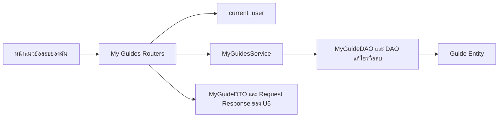

# Task65 U5 API จัดการแนวข้อสอบของฉัน

เอกสารนี้อธิบาย API ที่ใช้งานแล้วสำหรับดู แก้ไข และลบผลงานของผู้ใช้ ทุกคำขอต้องมี `Authorization: Bearer <access_token>` ที่ยังใช้ได้ รายการว่างไม่ใช่ข้อผิดพลาด และการแก้ไขหรือลบต้องเป็นเจ้าของรายการ

## เส้นทางและผลสำเร็จ

| Method | Backend path | Response |
|---|---|---|
| GET | `/api/my-guides` | `200 list[MyGuideDTO]` |
| PUT | `/api/my-guides/{guide_id}` | `200 MyGuideUpdateResponse` |
| DELETE | `/api/my-guides/{guide_id}` | `200 MyGuideDeleteResponse` |
| GET | `/guides/{guide_id}` | `200 GuideDetailResponseDTO` จาก API อ่านเดิมของ U3 |

Browser เรียก GET/PUT/DELETE ของ `/api/my-guides` ผ่าน Node proxy ด้วย path เดียวกัน ส่วนหน้าอ่านใช้ `/api/guides/guides/{guide_id}` ที่ proxy ส่งต่อเป็น `/guides/{guide_id}`

## ดูรายการของฉัน

```http
GET /api/my-guides
Authorization: Bearer <access_token>
```

Backend กรองด้วย username ที่ Session ยืนยันแล้ว ไม่รับ username หรือ publisher_id จาก query เพื่อเลือกดูผลงานของคนอื่น ผลสำเร็จเป็น array โดยตรง ไม่ครอบด้วย `items` หากไม่มีผลงานตอบ `[]`

ตัวอย่างข้อมูลสมมติ:

```json
[
  {
    "id": 42,
    "course_id": 1,
    "course_code": "CS261",
    "course_name": "INTRODUCTION TO SOFTWARE ENGINEERING",
    "instructor_name": null,
    "title": "แนวข้อสอบปลายภาค",
    "academic_year": 2568,
    "semester": 1,
    "exam_period": "final",
    "topics": "การออกแบบ API",
    "exam_format": "mixed",
    "objective_count": 20,
    "subjective_count": 3,
    "additional_advice": null
  }
]
```

ข้อมูลรายวิชาเป็นฟิลด์ระดับเดียวกับ Guide ไม่ใช่ object `course` ซ้อนอยู่ และ MyGuideDTO ไม่มี `publisher_name` เพราะรายการนี้กรองผลงานของบัญชีที่ Login อยู่แล้ว หน้าอ่านรายละเอียดใช้ DTO อีกแบบตาม U3

## แก้ไขและย้ายรายวิชา

```http
PUT /api/my-guides/42
Authorization: Bearer <access_token>
Content-Type: application/json
```

```json
{
  "course_id": 1,
  "title": "แนวข้อสอบปลายภาค ฉบับแก้ไข",
  "academic_year": 2568,
  "semester": 1,
  "exam_period": "final",
  "topics": "การออกแบบ API และฐานข้อมูล",
  "exam_format": "mixed",
  "objective_count": 18,
  "subjective_count": 4,
  "additional_advice": "ทบทวนการออกแบบข้อมูล"
}
```

ส่งข้อมูลครบตาม MyGuideUpdateRequest การแก้ไขคง Guide ID และเจ้าของเดิม หากเปลี่ยน `course_id` จะย้ายรายการเดิมไปวิชาใหม่ ไม่สร้างสำเนา ผลสำเร็จเป็น object แบบเดียวกับหนึ่งรายการในตัวอย่าง GET โดยใช้ค่าล่าสุด

| ฟิลด์ | กติกาสำหรับข้อมูลแก้ไข |
|---|---|
| `course_id` | บังคับ มากกว่า 0 และต้องมีรายวิชาในฐานข้อมูล |
| `title` | บังคับ ตัดช่องว่างหัวท้ายแล้วต้องไม่ว่าง ไม่เกิน 200 ตัวอักษร |
| `academic_year` | บังคับ หนึ่งใน 2566, 2567, 2568, 2569 |
| `semester` | บังคับ 1, 2 หรือ 3 โดย 3 คือภาคฤดูร้อน |
| `exam_period` | บังคับ midterm หรือ final |
| `topics` | บังคับ ตัดช่องว่างหัวท้ายแล้วต้องไม่ว่าง ไม่เกิน 2,000 ตัวอักษร |
| `exam_format` | บังคับ objective, subjective หรือ mixed |
| `objective_count`, `subjective_count` | เว้นได้หรือส่ง null หากระบุต้องมากกว่า 0 |
| `additional_advice` | เว้นได้ ไม่เกิน 2,000 ตัวอักษร ข้อความว่างหลัง trim เปลี่ยนเป็น null |

แบบ objective ต้องไม่ส่ง subjective_count และแบบ subjective ต้องไม่ส่ง objective_count ส่วนแบบ mixed เว้นจำนวนทั้งสองฝั่งได้ ไม่มีตัวเลือก other

Schema ปัจจุบันยังแปลงค่าบางชนิดเป็น integer และละทิ้ง field ส่วนเกิน ต่างจาก schema เผยแพร่ที่ใช้ strict integer และห้าม field เกิน การส่ง `publisher_id` ไม่สามารถเปลี่ยนเจ้าของได้ แต่ U5 ไม่ได้ปฏิเสธ field เกินทุกตัวด้วย 422

## ลบรายการ

```http
DELETE /api/my-guides/42
Authorization: Bearer <access_token>
```

เมื่อผู้ใช้ยกเลิกกล่องยืนยัน หน้าเว็บไม่ส่ง DELETE เมื่อยืนยันและลบสำเร็จตอบ `200` พร้อม body:

```json
{"id": 42, "message": "ลบแนวข้อสอบสำเร็จ"}
```

ลบเฉพาะ Guide ของเจ้าของ ไม่ลบ User หรือ Course ส่วน bookmark ใน saved_guides ที่อ้าง Guide นี้ถูกลบตาม FK CASCADE จึงไม่มีรายการบันทึกที่ชี้ไปยัง Guide ที่ลบแล้ว

## สิทธิ์และข้อผิดพลาด

Service อ่าน `users.id` จาก username ที่ผ่าน Login แล้ว DAO แก้ไขหรือลบด้วยเงื่อนไขทั้ง Guide ID และ publisher_id ไม่พึ่งการซ่อนปุ่มใน UI ผู้ใช้ไม่ใช่เจ้าของและรายการไม่พบตอบ 404 เหมือนกัน

| HTTP | `detail` หรือรูปแบบผลตอบกลับ | กรณี |
|---|---|---|
| 401 | ข้อความจาก current_user | ไม่มี token, token ใช้ไม่ได้ หรือหมดอายุ |
| 404 | `GUIDE_NOT_FOUND` | รายการไม่พบหรือไม่ใช่เจ้าของ |
| 422 | `GUIDE_ID_INVALID` | Guide ID ไม่เป็นค่าบวก |
| 422 | `COURSE_NOT_FOUND` | ไม่พบรายวิชาปลายทางในงานแก้ไข |
| 422 | รายการ validation errors ใน `detail` | path/body ไม่ผ่าน Pydantic |
| 500 | `GUIDE_UPDATE_FAILED` | SQLAlchemyError ใน workflow แก้ไข |
| 500 | `GUIDE_DELETE_FAILED` | SQLAlchemyError ใน workflow ลบ |

ตัวอย่างเมื่อแก้ไขหรือลบรายการที่ไม่พบ:

```json
{"detail": "GUIDE_NOT_FOUND"}
```

U5 ไม่ได้ใช้ ErrorResponseDTO ของ U3/U4 ทุกกรณี ส่วน GET รายการที่เกิด storage exception จะเป็น server error โดยไม่มี contract error.code เฉพาะ หาก proxy ติดต่อ backend ไม่ได้จะตอบ 502

## โครงสร้างที่ใช้งาน



- [dependencies.py](../../../backend/app/dependencies.py) ประกอบ service กับ DAO โดยใช้ Session เดียวกัน
- Router แยกเป็น [รายการ](../../../backend/app/routers/my_guides.py), [แก้ไข](../../../backend/app/routers/my_guide_updates.py) และ [ลบ](../../../backend/app/routers/my_guide_deletions.py)
- [MyGuidesService](../../../backend/app/services/my_guides.py) ควบคุม transaction ของงานเขียนและแปลง Entity เป็น DTO
- DAO แยกเป็น [MyGuideDAO](../../../backend/app/dao/my_guide_dao.py), [UpdateOwnedGuideDAO](../../../backend/app/dao/update_owned_guide_dao.py) และ [DeleteOwnedGuideDAO](../../../backend/app/dao/delete_owned_guide_dao.py)
- DTO จริงคือ [MyGuideDTO](../../../backend/app/schemas/my_guide.py), [MyGuideUpdateRequest/Response](../../../backend/app/schemas/my_guide_update.py) และ [MyGuideDeleteResponse](../../../backend/app/schemas/my_guide_delete.py)

## ข้อจำกัดของโค้ดปัจจุบัน

งาน update ตรวจรายวิชาปลายทางด้วย get_by_id ซึ่งตรวจการมีอยู่ ไม่ได้บังคับ CS-only ใน service นี้

งาน update commit ก่อนแปลง DTO ถ้าการอ่านเพื่อสร้าง DTO ล้มเหลวหลัง commit อาจตอบ error ทั้งที่ข้อมูลเปลี่ยนแล้ว การ rollback ไม่ย้อน commit ที่สำเร็จไปก่อนหน้า ส่วน network timeout ก็ไม่ยืนยันว่ารายการยังไม่เปลี่ยน ต้องโหลดข้อมูลใหม่ก่อนลองซ้ำ ข้อจำกัดนี้ยังไม่ได้แก้ในงานเอกสาร

ดู [Sequence Task66](task66-my-guides-management-sequence-diagram.md), [กติกา Task62](../requirements/task62-my-sample-exam-validation.md) และ [API อ่าน U3](../../U3/design/task35-guide-api.md)
