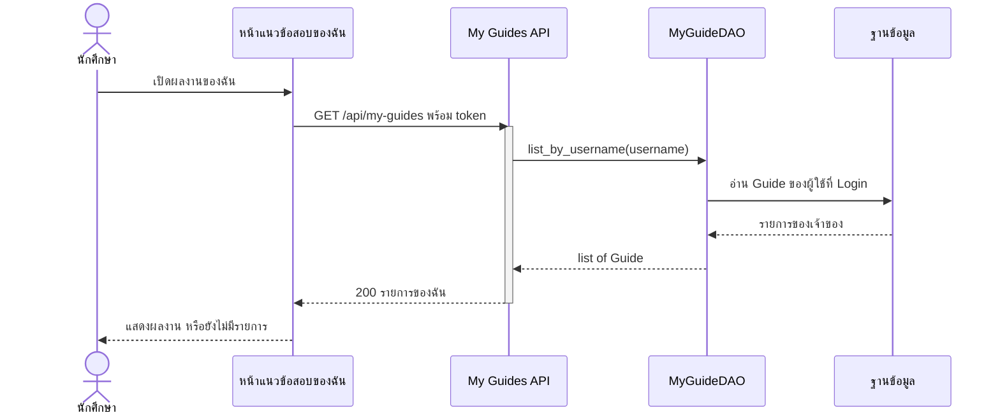
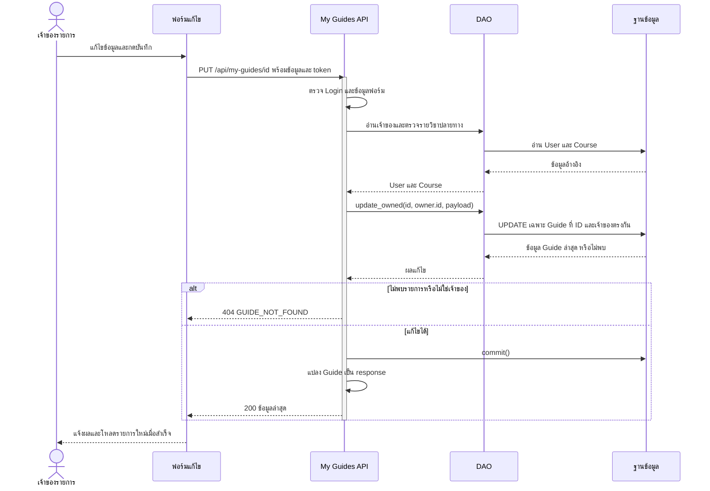
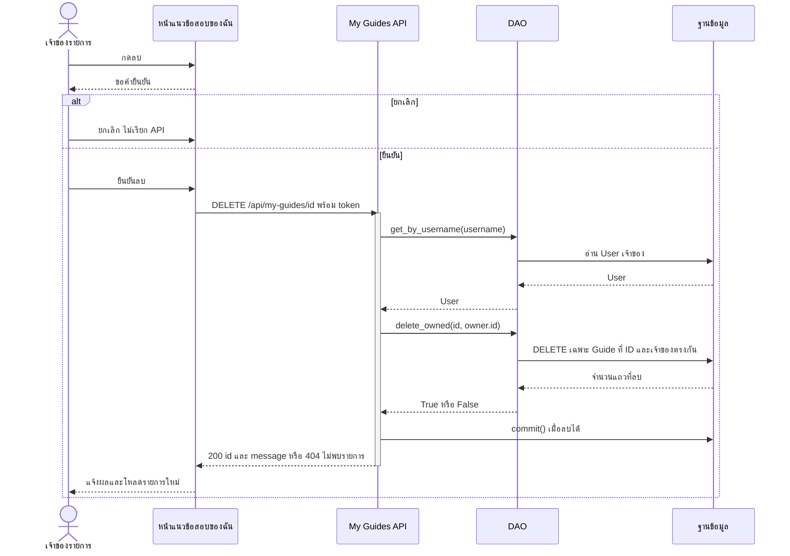

# Task66 U5 Sequence Diagram จัดการแนวข้อสอบของฉัน

ภาพแสดง flow ที่เชื่อม API แล้ว ได้แก่ ดูรายการ แก้ไขและย้ายวิชา และลบรายการของเจ้าของ Browser ใช้ GuideApi ผ่าน Node proxy ส่วน FastAPI router เรียก MyGuidesService ซึ่งรับ DAO และ Session จาก dependencies.py

ทุก request ต้องผ่าน `current_user` ซึ่งคืน `token` กับ `AuthenticatedUser` จาก Session ของ backend ก่อนเข้า service เมื่อ token ใช้ไม่ได้ตอบ `401 detail` และไม่เรียก workflow อ่านหรือแก้ข้อมูลของ Guide

ภาพใช้ระดับหน้าที่เพื่อให้อธิบายได้ง่าย: หน้าจอรวม JavaScript และ API client ส่วน API รวม Router กับ Service ภายใน Backend คำขอจาก Browser ยังผ่าน Node proxy และตรวจ Login ตามโค้ดจริง แต่ไม่แยกเป็น lifeline ในภาพ และ DAO ที่รวมไว้หมายถึง DAO หลายคลาสตามตารางอ้างอิง ชื่อ path บนลูกศรใช้ backend endpoint ยกเว้น U5 ที่ทั้งสองชั้นใช้ path เดียวกัน รายละเอียด validation และ error อยู่ในคำอธิบายประกอบ

## ดูรายการ

การอ่านไม่ commit ข้อมูล หากอ่านฐานข้อมูลล้มเหลว exception จะออกจาก router เป็น server error ไม่ได้ใช้ error envelope ของ GuideApiRoute จึงไม่ควรอ้างว่าทุก error ใน U5 เป็น `error.code=INTERNAL_ERROR`

## แก้ไขและย้ายรายวิชา

ถ้าเกิด SQLAlchemyError ในช่วง update, commit หรือสร้าง DTO service เรียก rollback แล้ว router ตอบ `500 detail=GUIDE_UPDATE_FAILED` ภาพแสดงลำดับจริงว่า DTO สร้างหลัง commit ดังนั้นหากอ่านข้อมูลเพื่อสร้าง DTO ล้มเหลวหลัง commit การ rollback ไม่ย้อนข้อมูลที่ commit ไปแล้ว ไม่รับรองว่า error ทุกกรณีหมายถึงไม่มีการเปลี่ยนแปลง

การย้ายวิชาแก้ `guides.course_id` ของรายการเดิม ไม่สร้างสำเนาหรือเปลี่ยนเจ้าของ Service ปัจจุบันตรวจรายวิชาปลายทางด้วย `get_by_id` ซึ่งตรวจการมีอยู่ ไม่ได้ใช้ `get_cs_by_id` ใน flow นี้

## ลบและยกเลิกการลบ

ถ้าเกิด SQLAlchemyError ก่อนลบสำเร็จ service เรียก rollback แล้วตอบ `500 detail=GUIDE_DELETE_FAILED` กรณี network failure หรือผลลบยืนยันไม่ได้ หน้าเว็บโหลดรายการใหม่ก่อนให้ผู้ใช้ตัดสินใจลองซ้ำ ไม่ถือว่า timeout หมายถึงลบไม่สำเร็จแน่นอน

## ไฟล์อ้างอิง

- [คำอธิบาย flow และ error](task66-my-guides-management-sequence-flow.md)
- [shared-courses.js](../../../frontend/public/js/shared-courses.js), [edit-form.js](../../../frontend/public/js/edit-form.js), [GuideApi](../../../frontend/public/js/guide-api.js) และ [Node proxy](../../../frontend/src/server.js)
- [dependencies.py](../../../backend/app/dependencies.py) และ [MyGuidesService](../../../backend/app/services/my_guides.py)
- [รายการ](../../../backend/app/routers/my_guides.py), [แก้ไข](../../../backend/app/routers/my_guide_updates.py) และ [ลบ](../../../backend/app/routers/my_guide_deletions.py)
- [MyGuideDAO](../../../backend/app/dao/my_guide_dao.py), [UpdateOwnedGuideDAO](../../../backend/app/dao/update_owned_guide_dao.py) และ [DeleteOwnedGuideDAO](../../../backend/app/dao/delete_owned_guide_dao.py)
- [ER ภาพรวม](../../U3/design/task36-db-er-entity-dao.md)
